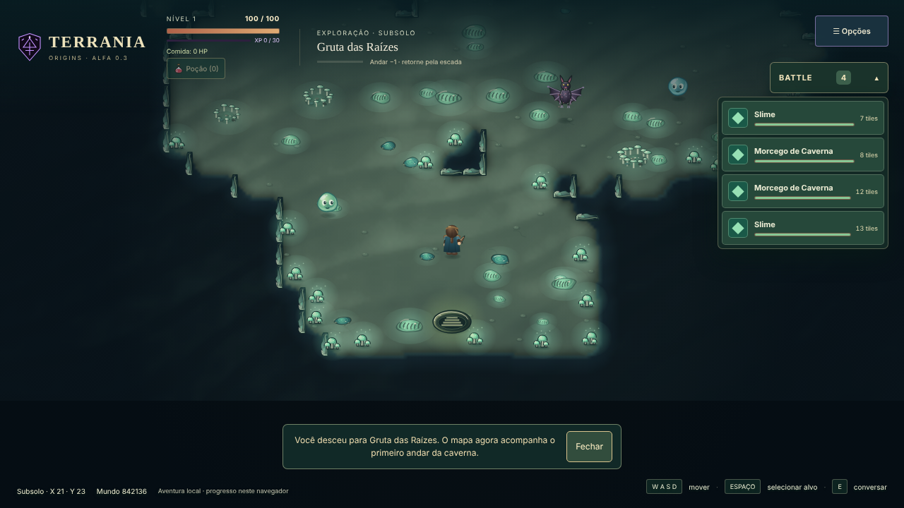

# Bestiário do Centro (campos, matas e a Gruta das Raízes)

**Proposta** (2026-11-26), na sequência do conserto das cavernas do Centro vazias ([ADR 0083](adr/0083-cavernas-do-centro-com-slimes.md)): hoje o Centro só tem o slime (e, nas cavernas comuns, seis slimes de arranjo provisório). **Todos os números e nomes são propostas que o dono ajusta.** **Feito:** o lote L1 ([ADR 0087](adr/0087-bestiario-do-centro-lote-1.md)): rato gigante, morcego de caverna e aranha das raízes, na Gruta das Raízes. **A fazer:** L2, L3 e L4. Mesmo molde: **um arquivo por criatura** em `src/monsters/center/<espécie>/`, painter em `src/render/creatures/center/...`, arte no contrato. O Centro é a região dos humanos e do começo do jogo: criaturas **fracas e comuns** (nível 1 a 20), para o jogador novo.

## As 12 criaturas (1 que existe + 11 novas)
| # | Criatura | Tier | Vida | Dano | XP | Ataque e efeito | Onde | Saque |
| ---: | --- | --- | ---: | ---: | ---: | --- | --- | --- |
| 1 | Slime *(existe)* | comum | 20 | 3 | 6 | pulo e contato | campos, caverna | Gel |
| 2 | Slime de Musgo | comum | 30 | 5 | 10 | lento, deixa uma poça que reduz a velocidade | matas úmidas, caverna | Gel esverdeado |
| 3 | Rato Gigante | comum | 28 | 5 | 9 | mordida rápida | vila, campos, caverna | Rabo de rato |
| 4 | Morcego de Caverna | comum | 24 | 6 | 11 | voa em zigue-zague, em bando | caverna | Asa de morcego |
| 5 | Aranha das Raízes | comum | 38 | 7 | 15 | teia: deixa lento; veneno fraco | matas, caverna | Fio de teia |
| 6 | Cobra-Cipó | comum | 34 | 8 | 14 | emboscada, veneno fraco | matas | Pele de cobra |
| 7 | Besouro de Raiz | comum | 55 | 6 | 17 | casca dura (defesa +), lento | campos, caverna | Carapaça |
| 8 | Javali Selvagem | médio | 110 | 14 | 45 | investida em linha reta | matas | Presa de javali |
| 9 | Lobo Cinzento | médio | 90 | 13 | 42 | em matilha, cerca o herói | matas | Pele de lobo |
| 10 | Cogumelo Andante | médio | 100 | 11 | 48 | nuvem de esporos (deixa lento) | caverna, matas | Esporos |
| 11 | Raiz-Viva | elite | 220 | 18 | 120 | raízes prendem o herói por 2 s | caverna | Seiva viva |
| 12 | **Ent Ancião da Gruta** | chefe | 650 | 28 | 450 | pisão e raízes de área | masmorra do Centro (a criar) | baú, Coração de Madeira |

## Onde moram
- **Campos e vila**: slime, rato gigante, besouro, javali.
- **Matas**: slime de musgo, aranha, cobra-cipó, lobo, cogumelo.
- **Gruta das Raízes** (tema `verdant`): slimes, morcegos, aranhas, ratos, besouros, cogumelo, raiz-viva. As seis posições que `CaveCentral.ts` sorteia (antes só de slimes) já são a **mistura** da caverna (a regra de pontos alcançáveis continua); os outros tipos entram na fila nos próximos lotes.

## Os lotes (proposta)
1. **L1 (feito, [ADR 0087](adr/0087-bestiario-do-centro-lote-1.md)):** rato gigante, morcego e aranha (3 a 5): a caverna do Centro com variedade (dois slimes, dois morcegos, um rato e uma aranha por caverna, a fila gira por entrada), o saque e o bot de QA.

   
2. **L2:** cobra-cipó, besouro, slime de musgo (2, 6, 7).
3. **L3:** javali, lobo, cogumelo (8 a 10) e as matas do Centro.
4. **L4:** a Raiz-Viva e a masmorra do Centro (3 andares), com o Ent Ancião.
Cada lote: ficha, painter, arte no contrato, saque, testes, e o bot de QA ganha as criaturas.
