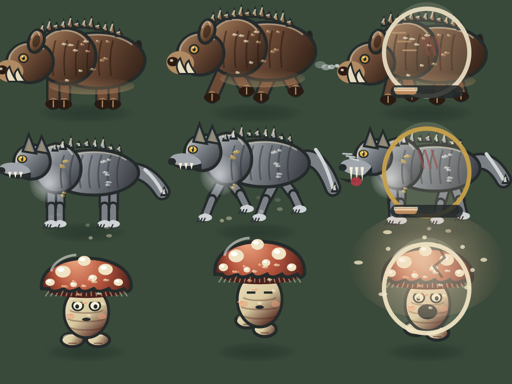

# Bestiário do Centro (campos, matas e a Gruta das Raízes)

**Proposta** (2026-11-26), na sequência do conserto das cavernas do Centro vazias ([ADR 0083](adr/0083-cavernas-do-centro-com-slimes.md)): hoje o Centro só tem o slime (e, nas cavernas comuns, seis slimes de arranjo provisório). **Todos os números e nomes são propostas que o dono ajusta.** **Feito:** o lote L1 ([ADR 0087](adr/0087-bestiario-do-centro-lote-1.md)): rato gigante, morcego de caverna e aranha das raízes, na Gruta das Raízes. **Feito também:** o lote L2 ([ADR 0088](adr/0088-bestiario-do-centro-lote-2.md)): slime de musgo, cobra-cipó e besouro de raiz. **Feito também:** o lote L3 ([ADR 0089](adr/0089-bestiario-do-centro-lote-3.md)): javali, lobo cinzento e cogumelo andante (os primeiros na superfície, só longe da vila). **Feito também (parte):** o lote L4a ([ADR 0094](adr/0094-masmorra-das-raizes-lote-4.md)): o status enraizado, a Raiz-Viva e o Ent Ancião da Gruta (fichas, desenho e efeito nos pés). **Feito também:** L4b, a Masmorra das Raízes (3 andares, em 40 % das cavernas verdes), onde moram os dois. Mesmo molde: **um arquivo por criatura** em `src/monsters/center/<espécie>/`, painter em `src/render/creatures/center/...`, arte no contrato. O Centro é a região dos humanos e do começo do jogo: criaturas **fracas e comuns** (nível 1 a 20), para o jogador novo.

## As 12 criaturas (1 que existe + 11 novas)
| # | Criatura | Tier | Vida | Dano | XP | Ataque e efeito | Onde | Saque |
| ---: | --- | --- | ---: | ---: | ---: | --- | --- | --- |
| 1 | Slime *(existe)* | comum | 20 | 3 | 6 | pulo e contato | campos, caverna | Gel |
| 2 | Slime de Musgo | comum | 30 | 5 | 10 | lento, deixa uma poça que reduz a velocidade | matas úmidas, caverna | Gel esverdeado |
| 3 | Rato Gigante | comum | 28 | 5 | 9 | mordida rápida | vila, campos, caverna | Rabo de rato |
| 4 | Morcego de Caverna | comum | 24 | 6 | 11 | voa em zigue-zague, em bando | caverna | Asa de morcego |
| 5 | Aranha das Raízes | comum | 38 | 7 | 15 | teia: deixa lento; veneno fraco | matas, caverna | Fio de teia |
| 6 | Cobra-Cipó | comum | 34 | 8 | 14 | emboscada, veneno fraco | matas | Pele de cobra |
| 7 | Besouro de Raiz | comum | 55 | 6 | 17 | casca dura (defesa +), lento | campos, caverna | Carapaça |
| 8 | Javali Selvagem | médio | 110 | 14 | 45 | investida em linha reta | matas | Presa de javali |
| 9 | Lobo Cinzento | médio | 90 | 13 | 42 | em matilha, cerca o herói | matas | Pele de lobo |
| 10 | Cogumelo Andante | médio | 100 | 11 | 48 | nuvem de esporos (deixa lento) | caverna, matas | Esporos |
| 11 | Raiz-Viva | elite | 220 | 18 | 120 | raízes prendem o herói por 2 s | caverna | Seiva viva |
| 12 | **Ent Ancião da Gruta** | chefe | 650 | 28 | 450 | pisão e raízes de área | masmorra do Centro (a criar) | baú, Coração de Madeira |

## Onde moram
- **Campos e vila**: slime, rato gigante, besouro, javali.
- **Matas**: slime de musgo, aranha, cobra-cipó, lobo, cogumelo.
- **Gruta das Raízes** (tema `verdant`): slimes, morcegos, aranhas, ratos, besouros, cogumelo, raiz-viva. Desde o [ADR 0101](adr/0101-toda-gruta-das-raizes-e-masmorra.md) toda gruta verde (menos a de treinamento da Aela) é a **Masmorra das Raízes**, de cinco andares: o primeiro tem rato, morcego, aranha, slime de musgo e besouro; a Raiz-Viva aparece do segundo andar para baixo, e o Ent Ancião mora no quinto. `CaveCentral.ts` (as seis posições sorteadas) deixou de existir.

## Os lotes (proposta)
1. **L1 (feito, [ADR 0087](adr/0087-bestiario-do-centro-lote-1.md)):** rato gigante, morcego e aranha (3 a 5): a caverna do Centro com variedade (dois slimes, dois morcegos, um rato e uma aranha por caverna, a fila gira por entrada), o saque e o bot de QA.

   
2. **L2 (feito, [ADR 0088](adr/0088-bestiario-do-centro-lote-2.md)):** cobra-cipó, besouro, slime de musgo (2, 6, 7). A fila da caverna passou a doze lugares (cada caverna usa seis seguidos); a poça do slime de musgo que reduz a velocidade do chão ficou para quando o terreno aceitar efeito de criatura.

   
3. **L3 (feito, [ADR 0089](adr/0089-bestiario-do-centro-lote-3.md)):** javali, lobo, cogumelo (8 a 10). Andam pela superfície do Centro a partir de 240 tiles da vila (em 20 % dos blocos; o lobo em matilha); o cogumelo também mora na caverna. As constantes de distância e de taxa são propostas que o dono ajusta.

   
4. **L4 (feito, [ADR 0094](adr/0094-masmorra-das-raizes-lote-4.md)):** a Raiz-Viva (elite que prende o herói) e a Masmorra das Raízes (3 andares, ou 2), com o Ent Ancião no fundo. **Ampliada** no [ADR 0101](adr/0101-toda-gruta-das-raizes-e-masmorra.md): 5 andares em toda gruta verde.
Cada lote: ficha, painter, arte no contrato, saque, testes, e o bot de QA ganha as criaturas.

## Acabamento do desenho
As nove criaturas foram refeitas ou detalhadas ([ADR 0093](adr/0093-detalhe-das-criaturas-do-centro.md)): o lobo, o javali, o rato, a aranha e o besouro com o kit de anatomia (patas articuladas, pelagem, carapaça); o morcego, a cobra, o slime de musgo e o cogumelo com mais camadas (veias, escamas, gel por dentro, fibras). Ficha, comportamento e saque não mudaram.
