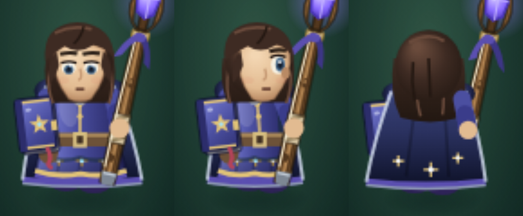

# A aparência do Mago: um personagem próprio que envelhece

**Proposta** do dono (2026-11-26), no mesmo molde dos cajados ([MAGO_CAJADOS.md](MAGO_CAJADOS.md)) e das roupas ([MAGO_ROUPAS.md](MAGO_ROUPAS.md)). **Todos os números e escolhas abaixo são propostas que o dono ajusta.** **Feito:** o lote M1 ([ADR 0081](adr/0081-personagem-do-mago-cabeca-jovem.md)): o Mago jovem, com cabeça, rosto e cabelo solto próprios. **A fazer:** M2 (a barba e o cabelo que envelhecem, e o nível chegando ao desenho) e M3 (o corpo e o acabamento).

## O pedido

O Mago deixa de ser "o Cavaleiro de chapéu": vira **outro personagem**, com rosto, cabelo e corpo próprios. Ele **começa jovem** e, conforme sobe de nível, **envelhece e se fortalece**: a barba cresce e embranquece, o cabelo (solto, nunca amarrado) cresce um pouco e embranquece, como os magos de O Senhor dos Anéis e de Harry Potter.

## Onde estamos hoje

- O Cavaleiro e o Mago usam **o mesmo corpo**: mesma cabeça, mesmo rosto, mesmo cabelo castanho com **rabo de cavalo**, mesmas pernas e braços. O Mago só troca as roupas (túnica, manto, chapéu) e o que segura (cajado, livro).
- O desenho do herói (`src/render/actors.ts`) cuida de tudo num lugar só, e a aparência da vocação (`HeroLook`) só troca túnica, manto, barra e chapéu. **Rosto, cabelo, barba e corpo não são trocáveis hoje.**
- O desenho não sabe o **nível** do herói (só a vocação, o cajado e o que veste); precisa passar a saber para o Mago envelhecer.

## O personagem do Mago

- **Cabeça e rosto próprios**: um pouco mais comprido e fino que o do Cavaleiro, queixo mais marcado, sobrancelhas próprias. Olhos mais azul-acinzentados (os do Cavaleiro continuam verde-escuros).
- **Cabelo solto, nunca amarrado**: sem rabo de cavalo, sem faixa. Cai em volta do rosto e atrás dos ombros; balança com o passo (como o manto). Quando usa o chapéu, o cabelo sai por baixo da aba.
- **Barba**: cresce por etapas (tabela abaixo), com o fio sempre solto, balançando um pouco com o vento do passo; de costas ela não aparece, só o cabelo.
- **Corpo**: o mesmo esqueleto de andar do Cavaleiro (para não refazer as animações de passo, golpe, conjurar e respiração), mas com **ombros um pouco mais largos** nas etapas finais ("mais forte") e uma postura que muda de leve (mais ereto e firme no início, mais imponente no fim). O Mago continua com 80% da vida do Cavaleiro; é só aparência.
- **O Cavaleiro não muda em nada.**

## As etapas da vida do Mago (proposta)

A idade depende **só do nível** (vale o nível, não o tempo de jogo). São **oito etapas**, que coincidem com os conjuntos de roupas e os cajados (assim cada salto de poder também é um salto de aparência):

| Etapa | Níveis | Quem é | Cabelo | Barba | Rosto e corpo |
| ---: | ---: | --- | --- | --- | --- |
| 1 | 1 a 9 | Aprendiz jovem | castanho, curto solto (até a nuca) | nenhuma | rosto liso, ombros magros |
| 2 | 10 a 19 | Jovem mago | castanho, chega ao pescoço | sombra rala no queixo | rosto liso |
| 3 | 20 a 29 | Adulto | castanho-escuro, chega ao pescoço | curta, castanha | traços mais firmes |
| 4 | 30 a 44 | Mago experiente | castanho com os primeiros fios grisalhos nas têmporas, nos ombros | média, castanha com fios grisalhos | linhas de expressão leves |
| 5 | 45 a 59 | Mago maduro | grisalho, até os ombros | cheia, grisalha | sobrancelhas grisalhas, ombros um pouco mais largos |
| 6 | 60 a 79 | Sábio | quase branco, passa dos ombros | longa, quase branca (cobre o peito) | rugas na testa e nos olhos |
| 7 | 80 a 99 | Mestre | branco, longo | branca, até o meio do peito | sobrancelhas brancas e grossas, ombros largos |
| 8 | 100 | Arquimago | branco-prata, bem longo | branca, até a cintura | olhar firme, a postura mais imponente |

- Quando o Mago **muda de etapa** (sobe para o nível 10, 20, 30...), a mensagem de nível ganha uma linha própria ("Seu Mago amadurece: a barba começa a crescer."). *Opcional; entra se o dono quiser.*
- A cor do cabelo e da barba **vai clareando por etapa** (castanho → grisalho → branco), nunca de repente fora das etapas.
- A **tela de escolha do herói** e a prévia do inventário mostram a etapa do nível atual (na escolha, o Aprendiz jovem).

## O desenho (como será feito)

- **Um arquivo por assunto** (regra do dono), numa pasta própria do Mago: `src/render/hero/mage/body/` com a cabeça e o rosto, o cabelo (atrás e à frente), a barba, as sobrancelhas e rugas, e a ficha de cada etapa (cores, comprimentos, largura dos ombros). Cada peça é registrada em `tests/helpers/artAssets.ts` e passa no contrato de arte, sem baixar piso e sem exceção nova.
- O `HeroLook` ganha a **cabeça do personagem**: se a vocação tem cabeça própria, o desenho do herói usa a dela no lugar do rosto, do cabelo e do rabo de cavalo do Cavaleiro. O Cavaleiro continua com o código dele (as 216 combinações de desenho dão a mesma assinatura de antes).
- O herói passa a carregar o **nível** para o desenho (`level` junto da vocação, no lote M2); quem não tem nível (prévias, escolha de herói) usa a etapa 1.
- A etapa vem de uma função pura do nível (`ageStage(level)`), sem aleatório; cabelo e barba balançam com o `walkTime`, como o manto.
- As roupas (túnica, manto, chapéu) continuam como estão e **vestem por cima**: o chapéu fica sobre o cabelo, a gola da túnica sobre a barba, o manto atrás.

## Os lotes (proposta)

1. **Lote M1 (feito, [ADR 0081](adr/0081-personagem-do-mago-cabeca-jovem.md)): o personagem do Mago, jovem.** A cabeça e o rosto próprios, o cabelo solto (sem rabo de cavalo) e o `HeroLook` com cabeça; o Cavaleiro igual a antes. O nível chegando ao desenho passou para o M2 (só faz sentido quando houver etapas para escolher). Captura do Mago jovem de frente, de lado e de costas.

   
2. **Lote M2: a barba e o cabelo que envelhecem, e o nível no desenho.** O herói passa a levar o `level` para o desenho; as etapas 2 a 8 (barba por comprimento, cabelo por comprimento e cor, sobrancelhas), com a captura das oito etapas lado a lado.
3. **Lote M3: o corpo que se fortalece e o acabamento.** Ombros e postura por etapa, rugas, a mensagem de nível e o ajuste das roupas sobre o corpo novo (túnica sobre os ombros mais largos, barba sobre a gola).

Cada lote vai com testes que falham sem a mudança, mutações, suíte completa do navegador e documento/ADR, como os anteriores.

## Decidido por enquanto (as opções recomendadas; o dono ajusta quando quiser)

1. **A idade segue o nível**, em oito etapas (a tabela acima), coincidindo com os conjuntos de roupas.
2. **Corpo:** mesmo esqueleto de andar do Cavaleiro, só com ombros e postura próprios (sem refazer animações).
3. **Cabelo sempre solto**; o chapéu fica por cima.
4. **Cor da pele:** a mesma do Cavaleiro; *não proposto aqui:* escolher tom de pele, gênero ou rosto na criação do herói (entra depois se o dono quiser).
5. **Mensagem ao mudar de etapa:** proposta, a confirmar.
6. **O Cavaleiro** não muda; um envelhecimento do Cavaleiro (cicatrizes, barba) seria uma entrega própria, em aberto.
