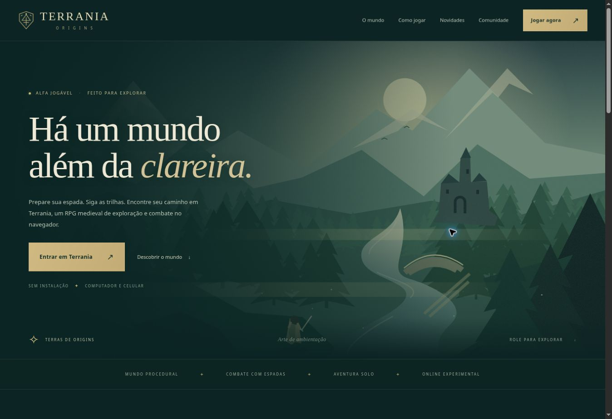
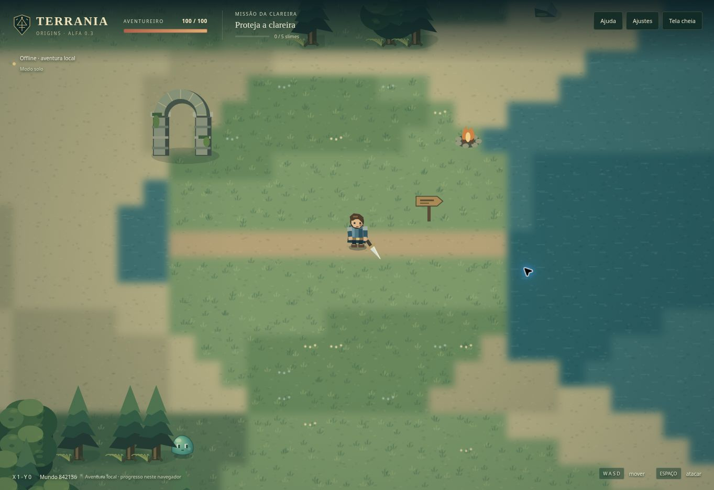

# Site e alfa 0.3

## Entradas separadas

| URL | Conteúdo |
| --- | --- |
| `/` | Apresentação e acesso à aventura |
| `/mundo/` | Clareira, floresta, rios e sementes |
| `/guia/` | Controles, combate, missão, solo/online e dúvidas |
| `/novidades/` | Notas da alfa 0.3 e próximos passos sem prazos prometidos |
| `/comunidade/` | Links de salas, convite copiável e relatos no GitHub |
| `/privacidade/`, `/termos/` | Funcionamento dos dados e condições do protótipo |
| `/jogar/` | Jogo com viewport completo, sem layout do site |
| `/404.html` | Página de endereço não encontrado |

O Vite compila todas as entradas. `scripts/verify-build.mjs` verifica os nove HTMLs, referências a assets, âncoras e links internos. O Cloudflare Pages continua usando `npm run build` e a pasta `dist`.

Links antigos `/?room=...` ou `/?seed=...` são encaminhados para `/jogar/`, preservando os parâmetros. `/jogar/?modo=solo` força a aventura local. O nome de sala admite somente `[a-z0-9-]` com 1–24 caracteres e não funciona como senha.

`src/site/` tem CSS e inicialização próprios. As capturas estáticas das páginas carregam o renderizador sob demanda; não iniciam o controlador do jogo, input, simulação, save ou WebSocket. A ilustração principal é SVG autoral de ambientação e está identificada como tal. As imagens em Canvas mostram o renderizador real.

## Mundo e movimento

- Piso com variação por seed, texturas e transições suavizadas. O buffer auxiliar inclui tiles vizinhos para evitar cortes entre chunks.
- Vegetação, pedras e marcos desenhados em ordem de profundidade junto aos personagens. Árvores/ arcos ficam translúcidos quando encobrem o herói.
- Pilares, placa e fogueira têm a mesma colisão no navegador e no servidor.
- Personagem em pé, capa, couro, armadura, expressão direcional, passos proporcionais à distância percorrida e espada com arco independente.
- Aceleração e frenagem integradas no tempo; limite de velocidade diagonal; areia mais lenta; colisão dividida em passos de até quatro pixels.
- Preparo de golpe, um impacto por ataque, alcance/cone/linha de visão compartilhados, recuo dos slimes e breve proteção após dano no herói.
- Passo local fixo de 1/60 s. O servidor continua com ticks de até 0,05 s e snapshots de aproximadamente 10 Hz; posições remotas recebem suavização apenas visual.
- Câmera com amortecimento exponencial, antecipação da caminhada, zoom entre 1× e 2,5×, teleporte sem arrasto longo e impacto opcional.
- Partículas e textos de dano têm limite de memória. Menus pausam o solo; online, bloqueiam comandos, mas a sala continua.
- Preferência por movimento reduzido é respeitada nos ajustes iniciais. Câmera e efeitos podem ser desativados separadamente.

## Compatibilidade online e publicação

**Atualizar frontend e servidor juntos.** As regras físicas, o tempo de ataque e a colisão dos marcos mudaram. O protocolo passa a versão 2; um cliente novo com servidor antigo continua no solo e informa que o servidor precisa ser atualizado.

O Dockerfile inclui `src/engine/combat.ts`, sem copiar renderizador, site ou navegador para o backend. Os lockfiles do frontend e servidor são versionados e o CI usa `npm ci`.

Nenhuma configuração da VPS, Caddy, domínio ou variável do Cloudflare é alterada por esta mudança de código. `VITE_MULTIPLAYER_URL` e `ALLOWED_ORIGINS` continuam seguindo `MULTIPLAYER_VPS.md`. O multiplayer continua sem contas e sem progresso permanente.

O save local usa a chave existente. Se uma posição antiga ficar dentro de um novo marco sólido, somente a posição retorna à clareira; vida, missão e criaturas derrotadas são preservadas.

## Verificação

- Testes puros: aceleração em 20/60 Hz, diagonal, frenagem, colisão, preparo/recuperação, alcance/parede, recuo, câmera, terreno, save e migração da posição.
- Testes do servidor: protocolo, sala e integração real com dois WebSockets, endpoint de saúde e movimento compartilhado.
- Build do frontend valida as nove páginas e referências internas.
- Build TypeScript do servidor; o CI também constrói e inicia a imagem Docker.
- Inspeção de site/jogo no navegador e em frames de 390 px, menus, zoom, teclado, controles móveis e convites.

A verificação visual em largura móvel não substitui teste de desempenho e toque em um aparelho físico. Não foram realizados testes de carga de produção.

## Prévias verificadas

