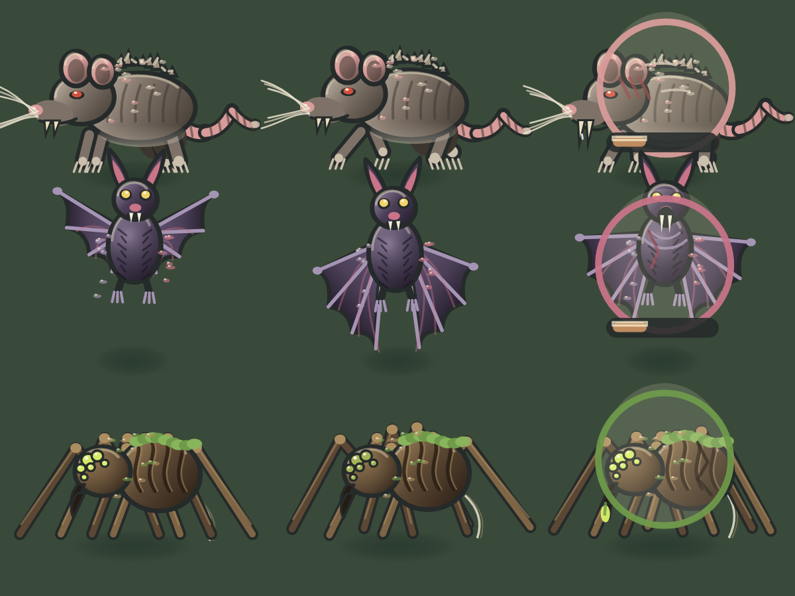

# ADR 0087 — Bestiário do Centro, lote 1: rato gigante, morcego de caverna e aranha das raízes

**Estado:** entregue em 2026-11-26, direto na `main`, a pedido do dono (variedade de criaturas por região; cavernas do Centro ainda "só com slimes"). É o primeiro lote do plano de [docs/BESTIARIO_CENTRO.md](../BESTIARIO_CENTRO.md) (12 criaturas do Centro, em quatro lotes). Os outros três bestiários (Leste, Oeste e Norte) estão documentados em `docs/BESTIARIO_*.md` e entram em lotes próprios.

## O que muda
1. **Três criaturas novas**, cada uma com a sua ficha, o seu comportamento e o seu desenho, cada coisa no seu arquivo:

   | Criatura | Vida | Dano | XP | Ritmo | Efeito | Saque |
   | --- | ---: | ---: | ---: | --- | --- | --- |
   | Rato Gigante (`giant-rat`) | 28 | 5 | 9 | corre aos arrancos e ronda o herói | só a mordida | Rabo de Rato Gigante (55 %), Dente de Roedor (30 %) |
   | Morcego de Caverna (`cave-bat`) | 24 | 6 | 11 | voa em zigue-zague (o maior do bestiário) e foge com 25 % de vida | só a mordida | Asa de Morcego (50 %), Guano Seco (25 %) |
   | Aranha das Raízes (`root-spider`) | 38 | 7 | 15 | anda de lado, com cuidado | veneno fraco (3 s) **e** a teia (`special: "web"`): lentidão de 2,5 s | Fio de Teia (50 %), Presa de Aranha (25 %) |

   Fichas em `src/monsters/center/{rats,bats,spiders}/`, desenhos em `src/render/creatures/center/{rats,bats,spiders}/`. O Centro é o começo do jogo: vida até 40, dano até 7, experiência até 15 (o resto do mundo chega a 450 de vida e 40 de dano).
2. **`REGIONAL_CREATURE_KINDS` passa de 31 para 34** (`CENTER_KINDS` em `monsters/catalog.ts`). O slime continua fora da lista regional (é anterior a ela). O tema `verdant` agora tem criaturas (`caveMonsterKinds("verdant")`), então a regra "o Centro não tem criatura regional" do [ADR 0083](0083-cavernas-do-centro-com-slimes.md) acabou.
3. **A Gruta das Raízes mistura o povo todo.** `engine/rooms/CaveCentral.ts` (que substitui `CaveSlimes.ts`) escolhe, para cada um dos seis pontos de uma caverna comum do Centro, quem nasce: **dois slimes, dois morcegos, um rato e uma aranha**, numa fila que **gira por caverna** (o ponto de partida vem do sorteio da própria entrada). Uma caverna com os seis pontos sempre tem os quatro tipos; as posições, a regra de "só onde o herói alcança", a garantia de três pontos e o save (`defeated`) são os de antes. O id do slime segue `<andar>:slime:<n>` e o das outras criaturas é `<andar>:mob:<n>` (o padrão das cavernas das outras regiões). A gruta de treino (sete slimes) e as cavernas dos outros temas **não mudaram**.
4. **A teia é um efeito novo, genérico:** `SpecialAttack` ganhou `"web"`; a mordida de quem tem esse especial aplica `slow` por 2,5 s além do que a ficha já aplica. Fica em `RegionalMonster.strike`, ao lado dos outros efeitos.
5. **Arte própria, com teste parte por parte.** Cada criatura exporta o desenho sem moldura (`drawGiantRat`, `drawCaveBat`, `drawRootSpider`: ctx, paleta, tempo e `CreatureMotion`) e o desenho com moldura (`render…Creature`), todos registrados em `tests/helpers/artAssets.ts` e dentro do contrato de arte, **sem baixar piso nem abrir `NOT_AN_ASSET`**. `CreatureMotion` (`render/creatures/shared/creatureMotion.ts`) é a leitura única do estado visual (passada, golpe, ferimento, semente), limitada a 0..1 e à prova de NaN. Reações: o rato e a aranha andam pela passada de verdade, as presas abrem e pingam no golpe, o rato arranha e a aranha racha com a vida baixa; o morcego bate asa mesmo parado, bate mais largo no voo, mais curto ferido, guincha no golpe e rasga a membrana do meio (as duas asas espelhadas).
6. **Saque:** os nomes novos entram como material da bolsa sozinhos (a lista vem das fichas) e rendem moeda pela experiência.
7. **Ainda não:** as três só moram na Gruta das Raízes; a superfície do Centro segue sem criaturas regionais (o plano do lote 3 inclui matas e campos).

As três criaturas em três momentos (parada, andando, golpeando e ferida; a moldura do jogo desenha o anel e a barra de vida):

## Verificação
- `tests/center-creatures.test.ts` (11): ficha de cada uma (números do documento, velocidade, alcance, intervalo, biomas, saque), um arquivo por criatura, comportamento (o morcego é o que mais zigue-zagueia e foge no amarelo), a mordida da aranha (lentidão e veneno) contra a do rato e a do morcego (sem efeito), fuga do morcego, não nascem na superfície nem em outros temas, saque e moeda, arte (silhueta própria, determinismo, passada, golpe, ferimento e semente **cada um por si**), `creatureMotion` e a geometria das asas do morcego (espelhadas, rasgo só na membrana do meio, bater curto).
- `tests/cave-central-monsters.test.ts` (9, no lugar de `cave-central-slimes.test.ts`): seis criaturas por caverna do Centro, em solo transitável, longe do herói e uns dos outros; a mistura (2 slimes, 2 morcegos, 1 rato, 1 aranha) em toda caverna e a fila que gira; determinismo; quem caiu não volta; a gruta de treino e os outros temas intactos; experiência e saque de cada abate; o herói de verdade derruba um de cada com a espada; a ligação em `CaveRoom`.
- Testes de contagem atualizados de 31 para 34 espécies (`monster-regions`, `regional-creatures`, `regional-wave2`, `south-common-bestiary`, `species-behavior`, `specialized-creature-art`); o de arte passou a exigir que **cada espécie aponte para o próprio desenho** no registro (antes bastava o `import` existir).
- Bot de QA: a varredura de cavernas ganhou o achado `roster` (a Gruta das Raízes tem os quatro tipos); relatório com 24 cavernas, 34 andares e 150 criaturas, tudo passando.
- `tests/browser/cave-center.spec.ts` (desktop e Android): entra numa caverna comum do Centro e confere que a lista de batalha mostra só nomes do povo do Centro. Captura em `docs/screenshots/caverna-do-centro.png`.
- Mutações: cerca de **50** estragos de propósito (cada campo da ficha, o efeito da teia e a duração, a fuga, o zigue-zague, o registro, o índice, o catálogo, a fila e o giro, os ids, os derrotados, a condição do tema, e cada reação do desenho). Na primeira rodada passaram batido oito estragos de verdade (mais um que caiu num comentário por erro meu): a velocidade da aranha, a troca da arte do morcego pela do rato (o registro não era conferido), e as reações do desenho ao golpe, ao ferimento e à passada (a moldura também reage ao golpe e à vida, e escondia a falta). Fechadas com o desenho testado sem a moldura, parte por parte, e a geometria das asas conferida chamada por chamada; essa mesma conferência fechou ainda dois que sobraram na segunda rodada (o rasgo só na asa esquerda e o bater que não encurtava ferido). Na rodada final, nenhum sobrevive.

## Limites e próximos passos
- Lote 2 do Centro: cobra-cipó, besouro de raiz e slime de musgo; lote 3: javali, lobo e cogumelo, com as matas; lote 4: raiz-viva, a masmorra do Centro de três andares e o Ent Ancião.
- A arte das três é mais enxuta que a das criaturas do Sul (cerca de 80 a 140 operações de pintura contra 230 a 320): passa o contrato com folga, e a revisão do dono dirá se pede mais acabamento.
- O "bando" do morcego (nascer em grupo) e o veneno que acumula da aranha não entraram; o lote seguinte pode propor.
