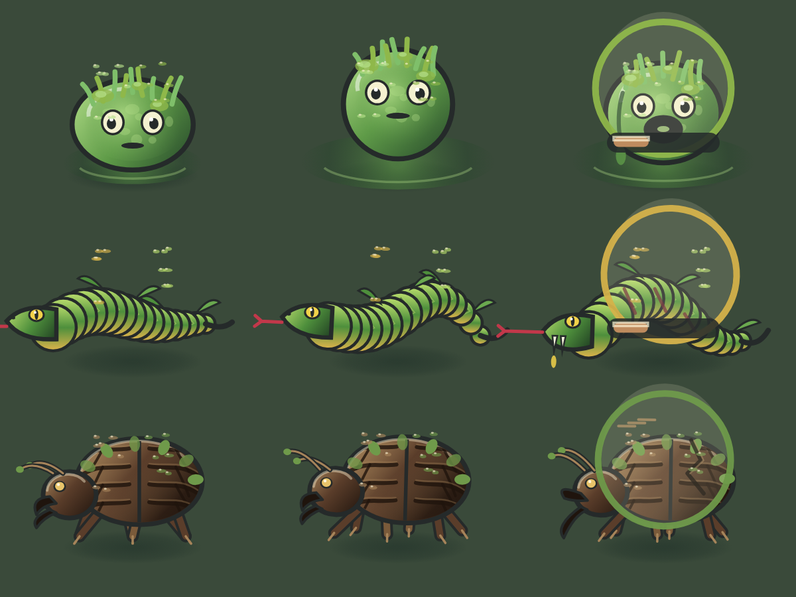

# ADR 0088 — Bestiário do Centro, lote 2: slime de musgo, cobra-cipó e besouro de raiz

> **Atualização ([ADR 0089](0089-bestiario-do-centro-lote-3.md)):** na fila de doze da Gruta das Raízes, o cogumelo andante passou a ocupar o lugar do segundo rato; o slime de musgo deixou de ser "o mais lento do Centro" (o cogumelo é mais lento). O texto abaixo é o registro do lote 2.

**Estado:** entregue em 2026-11-26, direto na `main`, na sequência do [ADR 0087](0087-bestiario-do-centro-lote-1.md) e do plano de [docs/BESTIARIO_CENTRO.md](../BESTIARIO_CENTRO.md). O Centro passa de 3 para **6 criaturas próprias** (além do slime comum).

## O que muda
1. **Três criaturas novas**, no mesmo molde do lote 1 (ficha, comportamento e desenho, cada um no seu arquivo):

   | Criatura | Vida | Dano | XP | Ritmo | Efeito | Saque |
   | --- | ---: | ---: | ---: | --- | --- | --- |
   | Slime de Musgo (`moss-slime`) | 30 | 5 | 10 | rasteja de frente, o mais lento dos que vão até o herói (46) | o contato deixa o herói lento por 2 s | Gel Esverdeado (60 %), Musgo Úmido (30 %) |
   | Cobra-Cipó (`vine-snake`) | 34 | 8 | 14 | ondula e se joga contra o herói (investida) | veneno fraco (4 s) | Pele de Cipó (50 %), Presa de Cobra-Cipó (25 %) |
   | Besouro de Raiz (`root-beetle`) | 55 | 6 | 17 | anda pesado e em linha reta | **casca dura: cada golpe do herói perde 1 de dano** | Carapaça de Raiz (50 %), Seiva Escura (20 %) |

   Fichas em `src/monsters/center/{slimes,snakes,beetles}/`, desenhos em `src/render/creatures/center/{slimes,snakes,beetles}/`. `REGIONAL_CREATURE_KINDS` passa de 34 para **37**; o Centro segue com vida até 55, dano até 8 e experiência até 17.
2. **A casca dura é a primeira armadura do Centro:** `ROOT_BEETLE_SHELL = 1` mora na ficha do besouro e entra em `RegionalMonster.defense` (que o golpe de espada e a magia já leem). Nenhum outro bicho do Centro tem armadura.
3. **A mistura da caverna agora é uma fila de doze** (`CENTRAL_ROSTER` em `engine/rooms/CaveCentral.ts`: 3 slimes, 2 ratos, 2 morcegos, 2 slimes de musgo, 1 aranha, 1 cobra e 1 besouro). Cada caverna comum do Centro usa **seis lugares seguidos**, a partir de um ponto sorteado pela própria entrada; qualquer janela de seis tem **ao menos um slime e quatro tipos** (conferido nos testes), e as cavernas juntas passam pelos sete tipos. Posições, regra de alcance, garantia de três pontos, ids (`:slime:` e `:mob:`) e save são os do lote 1.
4. **Arte com a mesma estrutura do lote 1:** cada criatura exporta o desenho sem moldura (`drawMossSlime`, `drawVineSnake`, `drawRootBeetle`) e o com moldura, registrados em `tests/helpers/artAssets.ts`, dentro do contrato, sem baixar piso nem abrir `NOT_AN_ASSET`; todos leem o mesmo `CreatureMotion`. Reações: o slime se achata e estica pela passada, a poça se espalha andando e a boca abre no golpe, a gota escorre ferido; a cobra ondula com a passada, a língua se estica e as presas pingam no golpe, e ganha marcas ferida; o besouro anda em passo alternado, abre as mandíbulas no golpe e o casco racha.
5. **Bot de QA:** o achado `roster` virou uma função pura (`centralRosterProblem`: sem slime, menos de quatro tipos ou bicho de fora do Centro) com teste próprio; o relatório continua passando.
6. **Ainda não:** a poça do slime de musgo que **reduz a velocidade do chão** (o terreno ainda não aceita efeito deixado por criatura; hoje o efeito é a lentidão do contato) e o veneno que acumula. Entram quando houver o mecanismo.

## Verificação
- `tests/center-creatures.test.ts` (14): as fichas das seis (números, saque, velocidade, alcance, intervalo, biomas), um arquivo por criatura, comportamento (o slime de musgo é o mais lento, a cobra avança de uma vez), o **efeito de cada mordida** (aranha: lentidão e veneno; musgo: só lentidão; cobra: só veneno; os outros: só machucam) e o dano da ficha, a casca do besouro (defesa 1 e 1 a menos por golpe), fuga só do morcego, só caverna, saque e moeda, arte (as seis silhuetas, determinismo, passada, golpe, ferimento e semente **cada um por si**), `creatureMotion`, a geometria das asas do morcego e as medidas exatas da poça, da boca e da língua.
- `tests/cave-central-monsters.test.ts` (9): a fila de doze (contagem por tipo, toda janela de seis com slime e variedade), as seis criaturas por caverna, os sete tipos nas cavernas varridas, o herói de verdade derruba cada tipo, experiência e saque da ficha de cada um.
- `tests/qa-caves.test.ts` (6): o achado `roster` nas quatro cavernas do Centro e a função que o decide.
- Testes de contagem atualizados de 34 para 37 espécies. `tests/browser/cave-center.spec.ts` aceita os sete nomes na lista de batalha.
- Mutações: **40** estragos de propósito (casca e seu valor, cada campo da ficha, o efeito do slime e da cobra, índice, catálogo, registro de comportamento e de arte, a fila, o QA e cada reação do desenho). Na primeira rodada cinco passaram batido: a conferência do QA (nunca era testada com entrada errada), a poça, a boca do slime e a língua da cobra (só mudavam números). Fechadas com a função pura do QA e com testes que medem a poça, a boca e a língua chamada por chamada. Última rodada: nenhum sobrevive.

## Limites e próximos passos
- L3: javali, lobo cinzento e cogumelo andante, com as matas e os campos do Centro (primeira presença na superfície); L4: raiz-viva, a masmorra do Centro de três andares e o Ent Ancião.
- A arte do slime de musgo é a mais enxuta do Centro (cerca de 40 operações de pintura); passa o contrato com folga.
