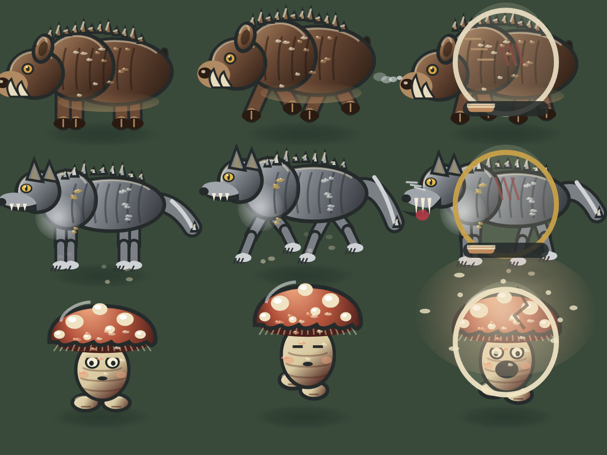
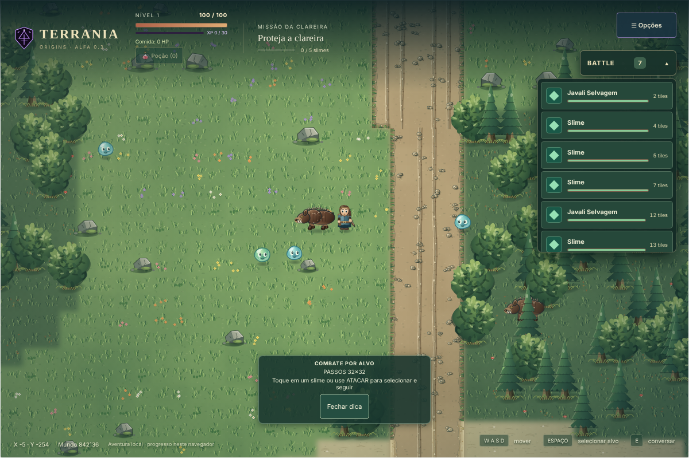

# ADR 0089 — Bestiário do Centro, lote 3: javali, lobo cinzento e cogumelo andante (e os primeiros bichos na superfície do Centro)

**Estado:** entregue em 2026-11-26, direto na `main`, na sequência dos [ADR 0087](0087-bestiario-do-centro-lote-1.md) e [0088](0088-bestiario-do-centro-lote-2.md) e do plano de [docs/BESTIARIO_CENTRO.md](../BESTIARIO_CENTRO.md). O Centro passa de 6 para **9 criaturas próprias** (além do slime comum) e, pela primeira vez, ganha criaturas regionais **andando pela superfície**.

## O que muda
1. **Três criaturas "médias"**, no molde dos lotes anteriores (ficha, comportamento e desenho, cada um no seu arquivo):

   | Criatura | Vida | Dano | XP | Ritmo | Efeito | Onde mora | Saque |
   | --- | ---: | ---: | ---: | --- | --- | --- | --- |
   | Javali Selvagem (`wild-boar`) | 110 | 14 | 45 | galope curto e investida direta | só a mordida | campos e matas | Presa de Javali (50 %), Couro Grosso (35 %), Carne de Javali (30 %) |
   | Lobo Cinzento (`gray-wolf`) | 90 | 13 | 42 | galope em arco: cada lobo cerca por um lado | só a mordida | matas, **em matilha de 2 ou 3** | Pele de Lobo (50 %), Presa de Lobo (30 %) |
   | Cogumelo Andante (`walking-mushroom`) | 100 | 11 | 48 | o mais lento do Centro (30), fica a distância e sopra | nuvem de esporos: lentidão de 3 s (ataque à distância de 72 px) | matas **e** Gruta das Raízes | Esporos de Cogumelo (60 %), Chapéu de Cogumelo (30 %) |

   Fichas em `src/monsters/center/{boars,wolves,mushrooms}/`, desenhos em `src/render/creatures/center/{boars,wolves,mushrooms}/`. `REGIONAL_CREATURE_KINDS` passa de 37 para **40**; `CENTER_WILD_KINDS` (em `monsters/catalog.ts`) lista os três que andam pela superfície.
2. **Surface do Centro, só longe da vila.** `actors/centerSpawns.ts` (`centerSurfaceSpawns`, ligado ao povoamento de `OfflineSimulation` ao lado dos slimes e dos encontros das outras regiões) sorteia **no máximo um encontro por bloco** (16 × 16 tiles), em cerca de 20 % dos blocos do Centro **a 240 tiles ou mais da Vila da Travessia**. Quem acabou de nascer só encontra slimes; javali, lobo e cogumelo aparecem depois de se afastar. O encontro respeita o Centro (nada nas outras regiões), as zonas protegidas (a vila e a capital), o chão transitável e o bioma de cada espécie. O lobo vem em matilha de dois (60 %) ou três (40 %), cada um num tile próprio a no máximo 3 tiles do primeiro e dentro do mesmo bloco. Os ids são `center-wild:<semente>:<bloco>:<n>` (estáveis; o derrotado volta pelo prazo normal da simulação).
3. **A fila da Gruta das Raízes** continua de doze lugares: o cogumelo entra no lugar do segundo rato (a fila fica com 3 slimes, 1 rato, 2 morcegos, 2 slimes de musgo, 1 aranha, 1 cobra, 1 besouro e 1 cogumelo). O javali e o lobo **não** moram em caverna. `caveMonsterKinds("verdant")` passa a ter 7 criaturas. A conferência do bot de QA (`centralRosterProblem`) agora só aceita, na caverna do Centro, o slime e quem mora na caverna (`caveMonsterKinds("verdant")`).
4. **Arte com a mesma estrutura**: cada criatura exporta o desenho sem moldura (`drawWildBoar`, `drawGrayWolf`, `drawWalkingMushroom`) e o com moldura, registrados no contrato de arte (sem baixar piso nem abrir exceção), todos lendo o mesmo `CreatureMotion`. Reações: o javali galopa, baixa a cabeça e solta vapor no golpe e ganha arranhões ferido; o lobo galopa com a cauda que se abre correndo, abre a boca e rosna no golpe; o cogumelo balança e alterna os pés no pulinho, solta uma nuvem de esporos que cresce no preparo do sopro e o chapéu racha ferido.

## Decisão de equilíbrio (para o dono ajustar)
- Os "médios" (90 a 110 de vida, 11 a 14 de dano) são bem mais duros que o slime. Por isso **a distância mínima é de 240 tiles** e **só 20 % dos blocos** têm encontro: o jogador novo cresce nos slimes e nas cavernas e só topa com eles depois. Os dois números são constantes (`CENTER_WILD_MIN_TILES`, `CENTER_WILD_CHANCE`) e cada um tem teste que reprova se mudar sem querer. Se quiser a mata do Centro mais calma ou mais perigosa, é só dizer os números.
- Em números: numa varredura de 161 × 161 blocos ao redor da vila, 3825 blocos têm encontro, com 2661 javalis, 1215 lobos e 602 cogumelos (os lobos vêm em matilhas de dois ou três).

## Verificação
- `tests/center-creatures.test.ts` (16): fichas das nove (números, saque, velocidade, alcance, intervalo, biomes), um arquivo por criatura, comportamento (cogumelo o mais lento, morcego o mais veloz, só o morcego foge), o efeito de cada mordida (incluindo a lentidão do cogumelo) e o dano da ficha, a casca do besouro, onde cada um mora, saque e moeda, arte (as nove silhuetas, passada, golpe, ferimento e semente cada um por si), `creatureMotion`, geometria das asas, e medidas exatas da poça, da boca, da língua, da cauda do lobo, da cabeça do javali e dos pés do cogumelo.
- `tests/center-wild.test.ts` (6, novo): encontros só além de 240 tiles e nenhum perto da vila; no Centro, em chão transitável, fora das zonas protegidas e da capital, no bioma da espécie, e a fração de blocos prometida; matilha de dois ou três (cerca de 40 % de três, quase nenhum lobo sozinho, no máximo 3 tiles do primeiro), javali e cogumelo sempre sós; ids estáveis e únicos, determinismo, semente diferente, entradas inválidas; só o Centro (nenhum encontro nas outras regiões, mesmo longe); o jogo de verdade povoa o entorno longe da vila e a vila só tem slimes.
- `tests/cave-central-monsters.test.ts` e `tests/qa-caves.test.ts` ajustados à fila com o cogumelo (oito tipos nas cavernas varridas). Contagens de 37 para 40 espécies nos testes que fixavam o total.
- `tests/browser/center-wild.spec.ts` (novo, desktop e Android): o herói começa a 3 tiles de um encontro sorteado pela semente e a lista de batalha mostra o nome da ficha. Captura em `docs/screenshots/centro-bichos-na-superficie.png`.
- Mutações: **52** estragos de propósito (distância, taxa, região, zonas protegidas, chão, bioma, tamanho da matilha, dispersão, tentativas, ids, o gancho no jogo, a fila, cada campo das fichas, o índice, o registro de comportamento e de arte e cada reação do desenho). Na primeira rodada sobreviveram sete: o gerador fora do Centro (a varredura de teste só cobria o Centro), a matilha sempre de três ou espalhada ou com uma só tentativa (o teste lia a constante do próprio código), e a cauda, o balanço e os pés do cogumelo (só mudavam números). Fechadas varrendo as outras regiões, medindo as matilhas com números fixos e conferindo a geometria chamada por chamada. Última rodada: nenhum sobrevive.

## Limites e próximos passos
- L4: raiz-viva, a masmorra do Centro de três andares e o Ent Ancião. Ainda ficam para depois: encontros do Centro mais variados nos campos (ratos e besouros na superfície), a poça do slime de musgo e o "bando" do morcego.
- O cogumelo é o único "médio" que também mora em caverna; um jogador de nível 1 na Gruta das Raízes pode topar com ele (100 de vida, mas lento e a distância). Se for pesado demais, a saída é tirá-lo da fila da caverna.
