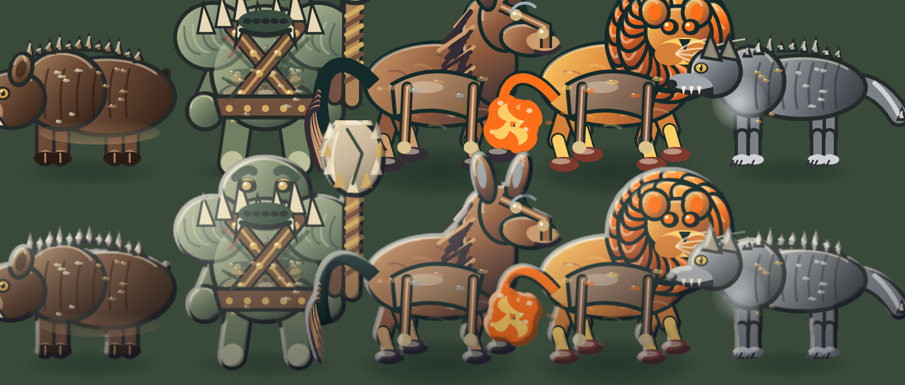

# ADR 0090 — A luz comum das criaturas e montarias, e o cache de quadros ("quase pré-renderizado")

**Estado:** entregue em 2026-11-26, direto na `main`, a pedido do dono: melhorar a qualidade das criaturas e montarias (as antigas "não têm muita qualidade") e, como o jogo é Canvas 2D procedural, deixá-las com ar de **modelo 3D pré-renderizado**. Esta é a primeira de três etapas (A: luz comum e cache; B: redesenhar as dez montarias; C: mais detalhe nas nove criaturas do Centro).

## O que é
Toda criatura e toda montaria passa a ser desenhada em uma tela de rascunho e recebe, **só dentro da silhueta**, as camadas de luz de uma cena única (`src/render/lighting/`):
1. **contorno interno escurecido** (volume arredondado, em vez de recorte chapado);
2. **degradê grande**: luz quente do alto à esquerda, sombra fria para baixo e à direita;
3. **quina iluminada** (a borda voltada para a luz brilha) e **quina na sombra** (a oposta escurece);
4. **oclusão junto ao chão**, onde a criatura toca a terra;
5. **brilho suave de material** no alto, do lado da luz.

A luz vem sempre do mesmo lado (`LightRig` em `lightRig.ts`: um objeto com todas as cores e medidas, que o dono ajusta num lugar só). Não troca nenhum desenho: vale para as 40 espécies e as 10 montarias, as antigas inclusive, e para as que vierem.

## Como funciona, em quatro arquivos (um assunto cada)
- `lightRig.ts`: a luz (direção, cores, larguras) e as caixas do sprite (`CREATURE_BOX`, `MOUNT_BOX`).
- `relight.ts`: as camadas. A luz é calculada em **meia resolução** (é macia por natureza e custa um quarto dos pixels) e entra de uma vez com `source-atop`. O desfoque vem de encolher e esticar a silhueta, e as quinas de subtrair a silhueta dela mesma deslocada: nada de `filter` nem de `shadowBlur`, que nem todo navegador entende.
- `spritePool.ts`: telas de rascunho reaproveitadas, e o **cache de quadros prontos** com dois tetos (64 quadros ou 10 milhões de pixels, cerca de 40 MB), reciclando as telas dos mais antigos.
- `litSprite.ts` (`drawLit`): desenha o corpo na escala atual da câmera, aplica a luz e guarda o quadro pela chave. Sem tela de verdade (testes sem navegador) ou com a luz desligada (`setLightingEnabled(false)`), desenha direto.

## "Pré-renderizado": os degraus
O estado visual entra em degraus antes de desenhar (`visualKey.ts`): o tempo em **10 quadros por segundo**, a fase da passada em **8 posições por volta** (o ciclo de caminhada de um sprite clássico), movimento, golpe e dor em décimos. O mesmo degrau dá o mesmo quadro, que volta do cache em vez de ser refeito. O balanço e o levantar de cada passo (`monsterPose`) continuam contínuos, fora do cache; o que fica em degraus é o interior do desenho.

## Custo (medido, e o orçamento que o limita)
Medido num navegador sem placa de vídeo (desenho por software, o pior caso), com 10 criaturas na tela numa escala de 3 pixels por unidade (zoom 1,5 numa tela de densidade 2):

| Situação | Sem luz | Com luz |
| --- | ---: | ---: |
| 10 andando | 1,6 a 2,4 ms por quadro | 14 a 17 ms |
| 10 paradas (só respiram) | 1,1 a 1,5 ms | 4,3 a 4,7 ms |

Cada quadro novo custa cerca de 2 ms por software (bem menos com tela acelerada por placa de vídeo, que é o caso dos celulares alvo). Para o pior caso não estourar, `beginLightingFrame()` (chamado no começo de `drawWorldView` e de `drawCaveView`) dá um **orçamento de 8 iluminações novas por quadro de tela**: passando dele, quem já tem quadro pronto reaproveita o último (a pose atrasa um degrau, 1/10 s) e só quem nunca foi visto é iluminado, para ninguém aparecer sem luz. Os tetos e o orçamento são números (`FRAME_CACHE_MAX`, `FRAME_CACHE_PIXELS`, o argumento de `beginLightingFrame`) que o dono ou o ADR de custo ajustam se um aparelho real pedir. O custo de download é desprezível (o bundle sobe 5 KB: 2348 KB de 2500 KB; comprimido 684 de 740 KB).

## O que fica de fora de propósito
- **O slime comum** (não passa pela luz: é gel translúcido, e o brilho de quina o deixaria turvo; entra numa etapa própria se o dono quiser).
- **O herói e os NPCs** (têm o próprio acabamento).
- **A barra de vida, a sombra no chão, o anel de golpe e o clarão de dor** ficam fora da luz: são indicadores, não corpo.
- **O desenho em si não melhora com a luz**: pernas de palito continuam palitos. Isso é a etapa B (montarias) e a C (criaturas do Centro).

## Verificação
- `tests/lighting.test.ts` (9): a direção da luz e as caixas; os degraus do estado visual (a chave muda com espécie, indivíduo, vida, movimento, golpe, dor, passada e tempo, e não muda dentro do mesmo degrau); o caminho sem navegador e com a luz desligada; **a ordem das camadas** conferida por um gravador de telas falsas (o desenho entra primeiro, uma só aplicação `source-atop`, a luz volta de meia resolução ao tamanho cheio, o degradê vai do alto à esquerda para baixo à direita, a quina iluminada vem do deslocamento (+, +) e a da sombra do (−, −), o contorno é furado no miolo, a oclusão acaba nos pés e o brilho fica do lado da luz); o cache (o mesmo estado não é redesenhado, a escala em degraus de um quarto entra na chave, os dois tetos, a reciclagem e o rejuvenescimento do mais recente); o orçamento por quadro; e a ligação nas três molduras e nas montarias (a barra de vida e os efeitos ficam depois do sprite).
- `tests/helpers/recordingContext.ts`: `withFakeDocument` **desliga a luz** (e limpa o cache) por padrão, para o contrato de arte continuar medindo o desenho (a luz acrescentaria operações que esconderiam um desenho fino); os testes da luz a ligam com `{ lighting: true }`. O contrato de arte, os pisos e a lista de exceções **não mudaram**.
- Mutações: **43** estragos de propósito (cada degrau, cada campo da chave, o filtro de luz desligada, a escala, o orçamento, a origem e o destino do quadro, a ordem e a direção de cada camada, os dois tetos, a reciclagem, o rejuvenescimento e a ligação nas molduras e nas montarias). Na primeira rodada três passaram batido (a escala em degraus de um quarto, o contorno sem furar o miolo, o cache sem rejuvenescer) e foram fechados; última rodada: nenhum sobrevive.
- Suíte do navegador completa; capturas em jogo conferidas a olho (`docs/screenshots/luz-comum-antes-depois.png`).

## Próximas etapas (a combinar com o dono)
- **B:** redesenhar as dez montarias (coxa, joelho e músculo, pelagem em camadas, sombreamento dentro do desenho).
- **C:** mais detalhe nas nove criaturas do Centro (pelos, escamas, dobras, brilho nos olhos, dentes e garras).
- **Regra daqui para a frente:** criatura nova já nasce pensada para a luz comum (volumes, não recortes chapados).
