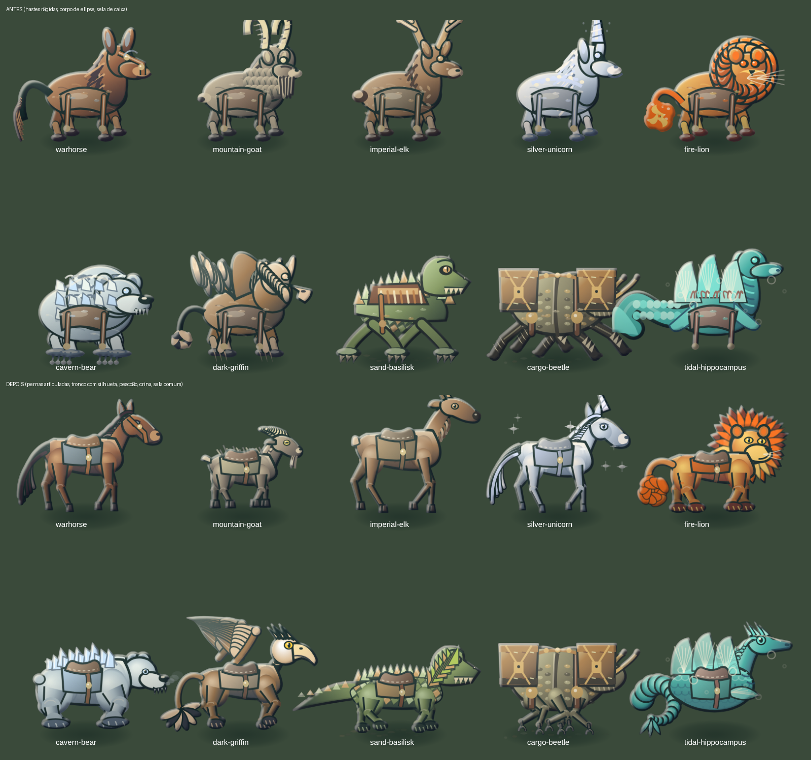

# ADR 0091 — Kit de anatomia e redesenho das dez montarias

**Estado:** entregue em 2026-11-26, a pedido do dono ("as montarias que o ChatGPT colocou não têm muita qualidade"). É a segunda das três etapas de qualidade (A: luz comum, ADR 0090; **B: montarias**; C: mais detalhe nas nove criaturas do Centro).

## O problema
As dez montarias eram um corpo em elipse com **quatro hastes rígidas** que só balançavam, uma sela de caixa desenhada igual em todas e cabeças coladas por cima. A luz comum (ADR 0090) deu volume, mas não conserta um desenho de palito: um cavalo continuava um burro de brinquedo.

## O que mudou
Um kit pequeno em `src/render/creatures/mounts/`, um assunto por arquivo, usado pelas dez montarias:

- `limbs.ts` — **pernas articuladas**: dois ossos afilados resolvidos por **cinemática inversa** (`legPose`). A pata vai para onde a passada manda (balanço para a frente e para trás, levantando no meio do passo), o osso nunca estica nem encolhe, e o **joelho do membro anterior dobra para a frente e o jarrete do posterior para trás**. Pé próprio da espécie: casco, casco fendido, pata com garras ou tarso de inseto.
- `torso.ts` — **tronco com silhueta** (cernelha, lombo, garupa, barriga que sobe para a virilha, peito), gradiente de cima para baixo, músculo do ombro e da anca, costelas e, no leão e no urso, franjas de pelo.
- `neck.ts` e `equineHead.ts` — pescoço afilado com arco e crina em mechas; cabeça de cavalo com orelhas, olho, narina e rédea (cavalo e unicórnio; o alce, o bode, o leão, o urso e o grifo têm a cabeça no próprio arquivo).
- `quadruped.ts` e `quadrupeds.ts` — o corpo de quatro patas montado do tronco e das pernas: pernas distantes, o que fica atrás do tronco, tronco, pernas próximas. A **passada anda em diagonais** (anterior próxima com posterior distante), no ritmo de sempre (`GAIT_RATE = 5`).
- `saddle.ts` — **uma sela comum** medida pelo tronco de cada espécie (manta, assento com costura, fivela, cilha).
- Cada espécie ficou com **medidas próprias** (`*_BODY`): o alce é o de pernas mais longas, o urso o de patas mais grossas, o bode tem casco fendido e chifres, o leão tem juba e a ponta da cauda, o grifo tem asa e bico. O lagarto, o besouro e o hipocampo reaproveitam as pernas e a sela, mas mantêm o corpo que já era diferente de um cavalo.

## Altura do cavaleiro
Antes o herói era desenhado 19 unidades acima dos pés em **qualquer** montaria. Agora cada montaria tem o seu lombo, e o herói senta na sela (`mountRiderLift`, em `quadrupeds.ts`, usado por `CanvasScene`): cavalo 28, bode 19, alce 32, unicórnio 26, leão 18, urso 23, grifo 22, lagarto 16; besouro e hipocampo seguem com 19.

## Luz, cache e contrato
- A montaria continua passando por `drawLit` com o cache de quadros (ADR 0090); o corpo entra em degraus de 1/10 s.
- O contrato de arte ganhou os desenhadores novos como ativos compostos (pernas, troncos, silhuetas, pescoços, crinas, cabeça, sela, corpo de quatro patas), **sem baixar nenhum piso**. Peças pequenas isoladas não passam os pisos de `prop`; por isso entram em ativos que juntam várias espécies e paletas. O pescoço passou a usar curvas suaves em vez de polígono.

## Testes (`tests/mount-anatomy.test.ts`, 14)
Comprimento dos ossos constante, joelho e jarrete para o lado certo (valores exatos), o pé de apoio no chão e o do ar nunca abaixo dele, alcance e piso do alcance, quatro pernas por montaria em diagonais e na ordem de desenho, a forma de cada perna vir da sua posição, silhueta do tronco, linha do pescoço, altura do cavaleiro de cada uma das dez, caixa da luz comum, determinismo, a passada andar ao longo do tempo, a sela, os enfeites da frente e o corpo próprio de cada espécie aparecerem na montaria inteira, e nenhum sorteio ou relógio no kit. Rodei **32 mutações** do kit (joelho invertido, diagonais quebradas, ordem de desenho, altura do cavaleiro etc.); as 32 são pegas (8 sobreviveram na primeira rodada e ganharam teste próprio).

## Fora desta etapa
Mais detalhe nas nove criaturas do Centro (etapa C), montarias por raridade e novos combates montados (ver `docs/MOUNTS.md`).
