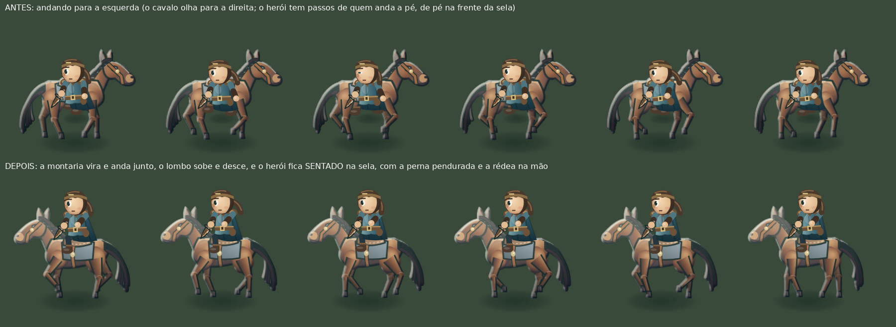

# ADR 0092 — O herói montado: a montaria vira, anda junto e o cavaleiro acompanha

**Estado:** entregue em 2026-11-26, a pedido do dono ("ainda tem que melhorar a animação do personagem montado"). É a etapa B2, entre o redesenho das montarias ([ADR 0091](0091-kit-de-anatomia-das-montarias.md)) e o detalhe das criaturas do Centro.

## O que estava errado
- A montaria **nunca virava**: desenhada sempre olhando para a direita, mesmo com o herói indo para a esquerda.
- A passada vinha do **relógio**, não da distância: a montaria marchava no lugar quando o herói parava.
- O herói por cima usava o **ciclo de passos de quem anda a pé** (pernas balançando, braços em oposição, sombra própria flutuando sobre o lombo).
- O lombo não se mexia, o herói não acompanhava nada, e ele sentava 2 unidades fora do centro da sela.

## O que mudou
Dois números novos, lidos pelos dois desenhos, de modo que andam juntos (`src/render/hero/ride.ts`, `src/render/creatures/mounts/gait.ts`):

- `MountRide { phase, moving, facing }`. `rideOf` tira isso do herói: **fase = distância andada** (`walkTime`, vezes 0,9), **movimento** suavizado de 0 (parado) a 1 (andando) e o **lado** em que a montaria olha, que **não volta para a direita** quando o herói só aperta para cima ou para baixo (memória por herói, limiar de 0,3 no olhar).
- A montaria (`renderMount(..., ride)`): vira (só o desenho é espelhado; a luz e a sombra no chão não), as patas balançam e levantam **na proporção do movimento** (parada, fica na pose de apoio, sem marchar no lugar), e o lombo, os enfeites e a sela **sobem e descem 1,1 unidade** no meio do apoio das diagonais. O lagarto e o besouro seguem a mesma fase; o hipocampo só vira.
- O herói (`renderHero` com `ride`, pose em `riderPose`) está **sentado na sela**, não de pé na frente dela: o fundo do tronco apoia no assento (o lombo menos dois, `riderLiftFor`), a **coxa sai do assento para a frente** (para onde a montaria olha), a **canela pendura até o estribo** com a bota, e **só a perna do lado da tela aparece** (a outra fica atrás do corpo da montaria, como numa vista de lado). Sem passos; **mãos na rédea**, à frente e subindo e descendo com a montaria; tronco que inclina 0,05 rad andando; **sobe e desce exatamente o que o lombo sobe**; sem sombra própria (a da montaria basta); e o golpe só avança 30 % do que avançaria a pé, para ele não sair da sela. Vale para o Cavaleiro e para o Mago (a túnica do Mago cobre a perna).
- O cavaleiro **senta no centro da sela** de cada montaria (`mountRiderShiftX`), do lado certo quando ela olha para a esquerda. As alturas mudaram em relação ao ADR 0091 (cavalo 41, bode 32, alce 45, unicórnio 39, leão 31, urso 36, grifo 35, lagarto 29; besouro e hipocampo seguem com 19), porque agora é o assento que fica sob ele, não os pés no estribo.
- Sem `ride` tudo continua como era: o cavalo selvagem e o que segue o herói na missão andam com o relógio.

## Cache (ADR 0090)
A montaria montada entra em quadros: **fase em 12 posições por volta**, movimento em décimos, lado e os enfeites (cauda, juba) em 6 quadros por segundo. A chave tem os quatro, então a mesma posição volta do cache e qualquer mudança refaz. O herói usa os mesmos degraus (`stepRide`), por isso sobe e desce junto com o quadro da montaria.

## Testes (`tests/rider-motion.test.ts`, 13, e um novo em `tests/lighting.test.ts`)
Degraus (12 posições, décimos, voltas, fase negativa, NaN), balanço do lombo, patas paradas versus andando nas dez montarias, espelho só do desenho (e a sombra antes dele), `rideOf` (fase, suavização, memória do lado, limiar), `riderPose` (valores exatos), pés, mãos, sombra e golpe do herói, o deslocamento da sela das dez, a ligação na cena e o cache real (mesmo quadro volta, outro refaz). Rodei **54 mutações** (lado invertido, patas marchando paradas, balanço sem a fase, chave do cache sem o lado, herói sem os degraus etc.); as 54 são pegas (8 sobreviveram na primeira rodada e ganharam teste próprio).

## Fora desta etapa
A rédea desenhada até o pescoço da montaria, a perna do lado de dentro aparecendo quando a montaria olha para cima ou para baixo, montaria que empina ou refuga, e a montaria olhando para cima ou para baixo (hoje só esquerda e direita, como as próprias montarias foram desenhadas).
