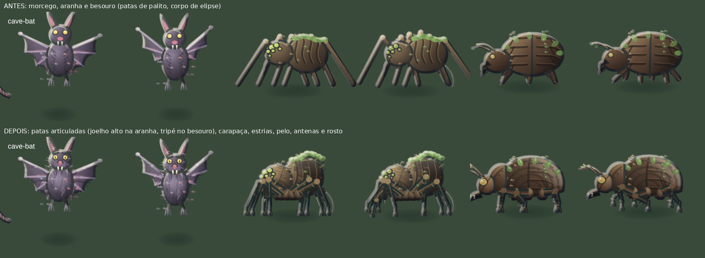
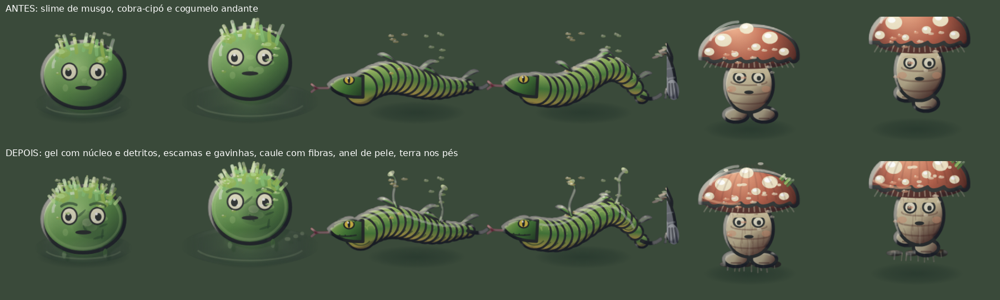

# ADR 0093 — Mais detalhe nas nove criaturas do Centro (etapa C, em três entregas)

**Estado:** concluído em 2026-11-26, em três entregas: C1 (lobo, javali e rato), C2 (aranha, besouro e morcego) e C3 (cobra, slime de musgo e cogumelo). É a terceira etapa de qualidade, depois da luz comum ([ADR 0090](0090-luz-comum-e-cache-de-quadros.md)) e das montarias ([ADR 0091](0091-kit-de-anatomia-das-montarias.md)).

## O problema
As nove criaturas do Centro eram elipses com hastes: patas de palito que só balançavam, espetos soltos no dorso no lugar de pelo, rosto de poucos traços. Ao lado das montarias novas destoavam.

## C1 — lobo, javali e rato

- **O kit de anatomia agora é comum** (`src/render/creatures/shared/anatomy/`): `limbs.ts` (pernas de dois ossos por cinemática inversa), `torso.ts` (tronco com silhueta), `quadruped.ts` (as quatro pernas em diagonais), `gait.ts` e `palette.ts` saíram da pasta das montarias, e as montarias e as criaturas usam os mesmos arquivos. Aceita qualquer paleta de três cores (`KitPalette`).
- **Pelagem em mechas** (`fur.ts`): `furAlong` põe mechas ao longo de uma linha do corpo (dorso, peito, barriga, cauda), cada uma uma curva que nasce na linha, sai para fora e se inclina para trás, com comprimento e cor que variam; `furFlow` deita mechas pelo flanco, dentro do contorno. Toda a variação vem de `unit(semente, i)`: o mesmo indivíduo tem sempre a mesma pelagem, e outro id tem outra.
- **Lobo:** tronco esguio de peito fundo e barriga recolhida, gola de pelo no pescoço, peito claro, cauda de pincel mais grossa no meio. Cabeça com focinho, nariz de couro, sobrancelha, olho âmbar de pupila estreita, orelhas com pelo por dentro e **mandíbula que gira na dobradiça** (0,5 rad no golpe, com presas, dentes e língua).
- **Javali:** ombros altos, barriga funda, patas curtas de casco partido, **crista de cerdas** que desce do cangote e pelo grosso pelo flanco. Cabeça de cunha com disco de focinho e ventas, olho pequeno de aro âmbar, orelha em folha, bochecha de cerdas e **dentes de marfim** que sobem 2 a mais no golpe; a cabeça inteira baixa 3.
- **Rato:** lombo alto e arqueado, pelo emaranhado, cauda longa e nua de anéis de pele, cabeça de focinho comprido com olho vermelho, orelhas redondas de pelo fino por dentro, bigodes que balançam e **dentões** que descem 3 no golpe.
- As três **olham para a esquerda**, como antes: o corpo é montado olhando para a direita (a convenção do kit) e espelhado, antes de a luz comum ser aplicada.
- **Parados, não marcham:** as patas ficam no apoio (a passada vem da fase e do movimento, como nas montarias). Passada, golpe e ferimento continuam lidos pelo mesmo `CreatureMotion`; ficha, comportamento e saque não mudam.

## Contrato de arte e testes
`furAlong` e `furFlow` entram no contrato como ativos compostos (lobo, javali e rato), sem baixar nenhum piso. `tests/center-anatomy.test.ts` (12): sorteio estável e em [0, 1), geometria exata das mechas (nasce na linha, lado, inclinação, comprimento, variação, determinismo), espelho, pernas do kit em diagonais e na ordem de desenho (distantes antes do tronco, próximas depois), joelho e apoio, parado versus andando, mandíbula, presas, dentes, arranhões por limiar, pelagem por indivíduo, caixa da luz comum e ausência de relógio. Os testes de medida exata do lobo e do javali em `tests/center-creatures.test.ts` foram reescritos para o desenho novo. **30 mutações** (lado das mechas, inclinação, espelho, dobradiça, presas, limiares de ferimento, ordem das pernas, quadril...) são todas pegas (2 sobreviveram na primeira rodada e ganharam teste próprio).

## C2 — aranha, besouro e morcego

- **O kit ganhou o solucionador solto** (`solveLeg(spec, x, y)` em `limbs.ts`): o pé vai para o ponto pedido, e `legPose` (a passada) passou a usá-lo. É o que serve a quem tem patas abertas em leque.
- **Aranha das Raízes:** oito patas de dois ossos (`SPIDER_LEGS`: duas para a frente e duas para trás de cada lado), de **joelho alto** (o quadril baixo e os ossos longos fazem o joelho subir acima do corpo), com cerdas, articulações e garras. As do lado distante, mais escuras e um pouco adiante, saem atrás do corpo; as diagonais alternam. Cefalotórax de carapaça com placas e pelos, **oito olhos**, dois palpos e **quelíceras com presas que abrem em tesoura** (3,4 por unidade de golpe, a gota de veneno só no golpe); abdômen de pelo curto, o desenho de raízes, o musgo e a fiandeira.
- **Besouro de Raiz:** seis patas (`BEETLE_LEGS`) em **tripés alternados**, com espinhos; casco em cúpula com **estrias que seguem a curva**, costura, nervuras, pontuações, borda escura e musgo; o **pronoto** (a placa do pescoço); cabeça com **olho de facetas**, **antenas de clava lamelada** que balançam e mandíbulas dentadas que abrem (4,08 para cada lado).
- **Morcego de Caverna:** as asas ganham **veias** que ramificam e as **juntas dos dedos** (a borda recortada e o rasgo da membrana não mudam), o corpo ganha **pelo** (mechas pelo peito e pela gola), as orelhas ganham **nervuras** e pelo fino, e o rosto ganha focinho com **folha nasal**, sobrancelha, pupila, presas grandes e pequenas e língua no guincho.
- Aranha e besouro, como o lobo, são **montados olhando para a direita e espelhados**, e **parados não marcham**.

**Testes** (`tests/center-arthropods.test.ts`, 8): oito patas em leque com ossos inteiros, joelho alto e pé no chão; passada alternada com valores exatos (e o pé nunca afunda); tripé do besouro; ordem das patas (distantes antes do corpo, próximas depois); quelíceras, mandíbulas, antenas e rachaduras por limiar; o morcego (juntas, nariz, língua, presas); caixa da luz comum e determinismo. **32 mutações** (patas, quadril, passo, quelíceras, mandíbulas, antenas, limiares, espelho, ordem das patas, `solveLeg`...) são todas pegas (6 sobreviveram na primeira rodada e ganharam teste próprio).

## C3 — cobra-cipó, slime de musgo e cogumelo andante

Estas três não têm pernas de dois ossos; o ganho é de **camadas**, e tudo o que os testes antigos já media (a língua, a poça, a boca, os pés, o caule) ficou exatamente igual.

- **Cobra-Cipó:** escamas (a barriga em placas largas e as costas em fileiras de três escamas pequenas, só nos segmentos de raio ≥ 3, mais um brilho em cada), brilho corrido ao longo do dorso, **duas gavinhas de cipó** com folhinha, nervura e gota de orvalho nas folhas e, na cabeça, crista sobre o olho, três escamas grandes na testa, a linha da boca e as quatro fossetas de calor do lábio.
- **Slime de Musgo:** por dentro, a **espessura da parede** (um contorno 1,9 para dentro), um **núcleo escuro** que flutua, cinco detritos em suspensão, a luz que atravessa por baixo, duas gotas que pendem e, andando, três **respingos** que ficam para trás; no alto, a franja de **fibras de musgo** (as mesmas mechas do kit de pelagem) e dois trevos; no rosto, sobrancelhas que sobem no golpe e o brilho de baixo dos olhos.
- **Cogumelo Andante:** **terra e raízes** nos pés (quatro torrões), **fibras** no caule, o **anel de pele** logo abaixo do chapéu, onze **nervuras** que saem do alto do chapéu, pintas pequenas espalhadas (por indivíduo), a luz da borda e um tufo de musgo num lado.

**Testes** (`tests/center-details.test.ts`, 6): escamas e placas medidas segmento a segmento, gavinhas, gotas, fossetas, parede, núcleo (com a fórmula do relevo), detritos, respingos, fibras, trevos, sobrancelhas, terra, anel, nervuras, pintas por semente e olhos antigos intactos; caixa da luz comum, determinismo e ausência de relógio. **27 mutações** são todas pegas (6 sobreviveram na primeira rodada e ganharam teste próprio).

## Resultado da etapa
As nove criaturas do Centro têm o acabamento das montarias: patas articuladas onde há patas, pelagem e carapaça em camadas, rosto com olhos, presas e dentes, tudo sob a luz comum ([ADR 0090](0090-luz-comum-e-cache-de-quadros.md)). Ficha, comportamento e saque não mudaram.

**Regra daqui para a frente:** criatura nova de quatro patas nasce no kit de anatomia e na pelagem em mechas; criatura sem patas nasce em camadas (escamas, gel por dentro, fibras) e pensada para a luz comum.
