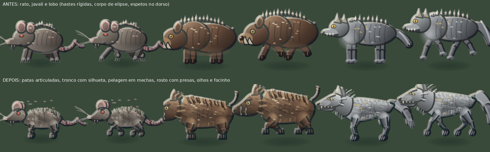

# ADR 0093 — Mais detalhe nas nove criaturas do Centro (etapa C, em três entregas)

**Estado:** C1 entregue em 2026-11-26 (lobo, javali e rato). C2 (aranha, besouro e morcego) e C3 (cobra, slime de musgo e cogumelo) seguem nas próximas entregas, no mesmo ADR. É a terceira etapa de qualidade, depois da luz comum ([ADR 0090](0090-luz-comum-e-cache-de-quadros.md)) e das montarias ([ADR 0091](0091-kit-de-anatomia-das-montarias.md)).

## O problema
As nove criaturas do Centro eram elipses com hastes: patas de palito que só balançavam, espetos soltos no dorso no lugar de pelo, rosto de poucos traços. Ao lado das montarias novas destoavam.

## C1 — lobo, javali e rato

- **O kit de anatomia agora é comum** (`src/render/creatures/shared/anatomy/`): `limbs.ts` (pernas de dois ossos por cinemática inversa), `torso.ts` (tronco com silhueta), `quadruped.ts` (as quatro pernas em diagonais), `gait.ts` e `palette.ts` saíram da pasta das montarias, e as montarias e as criaturas usam os mesmos arquivos. Aceita qualquer paleta de três cores (`KitPalette`).
- **Pelagem em mechas** (`fur.ts`): `furAlong` põe mechas ao longo de uma linha do corpo (dorso, peito, barriga, cauda), cada uma uma curva que nasce na linha, sai para fora e se inclina para trás, com comprimento e cor que variam; `furFlow` deita mechas pelo flanco, dentro do contorno. Toda a variação vem de `unit(semente, i)`: o mesmo indivíduo tem sempre a mesma pelagem, e outro id tem outra.
- **Lobo:** tronco esguio de peito fundo e barriga recolhida, gola de pelo no pescoço, peito claro, cauda de pincel mais grossa no meio. Cabeça com focinho, nariz de couro, sobrancelha, olho âmbar de pupila estreita, orelhas com pelo por dentro e **mandíbula que gira na dobradiça** (0,5 rad no golpe, com presas, dentes e língua).
- **Javali:** ombros altos, barriga funda, patas curtas de casco partido, **crista de cerdas** que desce do cangote e pelo grosso pelo flanco. Cabeça de cunha com disco de focinho e ventas, olho pequeno de aro âmbar, orelha em folha, bochecha de cerdas e **dentes de marfim** que sobem 2 a mais no golpe; a cabeça inteira baixa 3.
- **Rato:** lombo alto e arqueado, pelo emaranhado, cauda longa e nua de anéis de pele, cabeça de focinho comprido com olho vermelho, orelhas redondas de pelo fino por dentro, bigodes que balançam e **dentões** que descem 3 no golpe.
- As três **olham para a esquerda**, como antes: o corpo é montado olhando para a direita (a convenção do kit) e espelhado, antes de a luz comum ser aplicada.
- **Parados, não marcham:** as patas ficam no apoio (a passada vem da fase e do movimento, como nas montarias). Passada, golpe e ferimento continuam lidos pelo mesmo `CreatureMotion`; ficha, comportamento e saque não mudam.

## Contrato de arte e testes
`furAlong` e `furFlow` entram no contrato como ativos compostos (lobo, javali e rato), sem baixar nenhum piso. `tests/center-anatomy.test.ts` (12): sorteio estável e em [0, 1), geometria exata das mechas (nasce na linha, lado, inclinação, comprimento, variação, determinismo), espelho, pernas do kit em diagonais e na ordem de desenho (distantes antes do tronco, próximas depois), joelho e apoio, parado versus andando, mandíbula, presas, dentes, arranhões por limiar, pelagem por indivíduo, caixa da luz comum e ausência de relógio. Os testes de medida exata do lobo e do javali em `tests/center-creatures.test.ts` foram reescritos para o desenho novo. **30 mutações** (lado das mechas, inclinação, espelho, dobradiça, presas, limiares de ferimento, ordem das pernas, quadril...) são todas pegas (2 sobreviveram na primeira rodada e ganharam teste próprio).

## Falta (C2 e C3)
Aranha das raízes, besouro de raiz e morcego de caverna (C2); cobra-cipó, slime de musgo e cogumelo andante (C3): mesmo kit onde couber (patas articuladas na aranha e no besouro), carapaça, asas, escamas e rosto com mais camadas.
