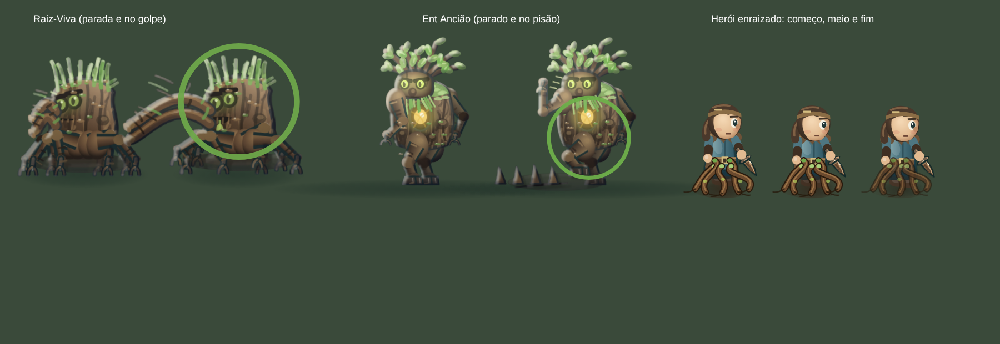

# ADR 0094 — Centro, lote 4: Raiz-Viva, Ent Ancião e a Masmorra das Raízes

**Estado:** lotes 4a (o status "enraizado", a Raiz-Viva e o Ent Ancião) e 4b (a Masmorra das Raízes que os abriga) entregues em 2026-11-27. O dono deixou a escolha do próximo assunto por conta do Claude; este fecha o bestiário do Centro de [docs/BESTIARIO_CENTRO.md](../BESTIARIO_CENTRO.md).

## Lote 4a

### Um status novo: enraizado
`DebuffKind` ganhou `"root"`: o herói **não anda, mas ainda luta** (o atordoado também não luta). É o `movementMultiplier` do `Player` que vira 0 (vale para a caminhada livre da caverna, para a por casas da superfície e para o recuo), a velocidade é zerada como no gelo e no atordoamento, e a raiz vale mais que a lentidão. Como os outros status: dura o que a ficha diz (no máximo 12 s), `cleanse` e o descanso na hospedaria o tiram, e ele atravessa a porta da caverna (`syncAdventureStateFrom`). Número inválido (NaN, infinito, negativo) não enraíza.

Duas habilidades novas (`SpecialAttack`): `roots` e `root-quake`. O pisão do Ent (`root-quake`) ainda **atordoa 0,6 s** quem está a menos de 54 de distância; as raízes vêm do status da própria ficha.

### Raiz-Viva (elite)
`living-root`: vida 220, dano 18, 120 de experiência, velocidade 36, alcance 30, intervalo 2,6 s; a pancada **enraíza por 2 s**. Seiva Viva (60 %) e Raiz Retorcida (40 %). Rasteja direto para o herói e não foge (`crawl`, `direct`). Desenho: um tronco retorcido de casca em sulcos fundos, nós, musgo e **rosto escavado de olhos de seiva acesa**, sobre **quatro raízes-perna de joelho alto** (cinemática inversa do kit de anatomia, ADR 0093, com a ponta em gancho); no golpe **duas raízes compridas e espinhosas chicoteiam 20 para a frente**, a boca abre e a seiva escorre; ferida, a casca racha e vaza.

### Ent Ancião da Gruta (chefe)
`elder-cave-ent`: vida 650, dano 28, 450 de experiência, velocidade 20, **alcance 90**, intervalo 3,4 s; as **raízes em área prendem por 2,5 s** (de longe, a pancada é 75 % do dano e não atordoa) e o **pisão de perto atordoa 0,6 s**. Coração de Madeira (70 %), Madeira Antiga (90 %) e Seiva Viva (50 %); o baú do chefe é o de todo chefe de masmorra (a moeda em dobro de `caveDefeatDrops`). Desenho: uma árvore de pé, de duas pernas de raiz (`cloven`) e dois braços de galho de dedos de graveto, tronco com o **vão do peito onde o Coração de Madeira pulsa**, cabeça com sobrancelha pesada, olhos de brasa, nariz de nó, barba de musgo e coroa de sete galhos com folhas. No golpe a perna de perto sobe 5 (o pisão), o braço de perto sobe 30 acima da cabeça, o chão racha e quatro raízes brotam à frente. É desenhado a 88 % para a coroa caber na caixa da luz comum.

### O efeito nos pés
`renderRootedFeet` (`src/render/rootedFeet.ts`): cinco raízes que sobem em espiral pelas botas, com casca, musgo, folhinhas e terra; **nascem aos poucos** (alfa 0,25 aos 2,6 s restantes), ficam inteiras no meio e **murcham nos últimos 0,4 s**, e balançam. A cena de superfície e a caverna as desenham ao lado do herói (no chão, não sobre a montaria).

### Onde moram (por enquanto)
Em lugar nenhum: `biomes: []` (não nascem na superfície), ficam fora da mistura de doze da Gruta das Raízes e só aparecem nos andares da masmorra (4b). As duas entram em `CENTER_DUNGEON_KINDS`, separadas dos nove `CENTER_KINDS` do começo do jogo (a elite e o chefe fogem da faixa "fraco e comum" do Centro: o teste de ficha ganhou a faixa deles, vida de 200 a 700 e dano de 15 a 30).

## Testes e mutações
`tests/center-dungeon-creatures.test.ts` (8): o status (não anda 1,8 s e anda depois, luta enraizado e não atordoado, `cleanse`, atravessa a porta, limite de 12 s, entradas inválidas, vale mais que a lentidão, preso também no modo por casas); as duas fichas e o comportamento; as pancadas medidas (dano, 2 s, 2,5 s, o pisão perto e o limite de 54, as raízes de longe, fora do alcance ninguém é ferido); a anatomia das duas (ossos inteiros, medidas, passo em oposição, pisão, braço, chicote, coração, raízes do chão); o registro, a caixa da luz comum e o determinismo; as raízes nos pés (nascer, meio, murchar, entrada inválida, balanço) e a ligação na cena e na caverna. Os testes de contagem do bestiário passaram de 40 para 42 espécies e o de "onde moram" ganhou as duas. **36 mutações**: 35 são pegas e uma é equivalente (zerar a velocidade quando enraizado é redundante: o multiplicador 0 já a zera); 5 sobreviveram na primeira rodada e ganharam teste próprio.

## Lote 4b — a Masmorra das Raízes

### Quais cavernas viram masmorra
Até aqui uma masmorra valia para **todas** as cavernas do tema (a Cripta das Dunas, o Brejo). No Centro isso tiraria a Gruta das Raízes comum, que o dono já conhece e que o jogador novo visita. Por isso `DungeonDefinition` ganhou o campo opcional **`share`** (fração de 0 a 1): `usesDungeon(dungeon, entrance)` sorteia pela posição da entrada (`hash2(tileX, tileY, seed + 7013)`), então a mesma entrada é sempre a mesma coisa, em qualquer máquina. A Masmorra das Raízes tem `share: .4` (no mundo de teste, 175 das 411 cavernas verdes comuns: 43 %). As outras 60 % seguem como a Gruta das Raízes comum, com os doze moradores de antes.

A **caverna de treinamento da Aela** (`cave:SEED:0:0`) nunca é masmorra, mesmo que o sorteio a escolhesse: `isStarterCave` (em `src/world/caves.ts`) a reconhece e `dungeonFor` devolve nada para ela. O jogador novo continua com um andar só, slimes e nada de elite.

### Os três andares (`src/dungeons/center/masmorra-das-raizes.ts`)
| Andar | Encontros | Moradores | Chefe |
| --- | --- | --- | --- |
| 1. Raízes Rasas | 4 | rato gigante, morcego, aranha das raízes, slime de musgo, besouro de raiz | — |
| 2. Galeria dos Cipós | 5 | cobra-cipó, cogumelo andante, aranha, besouro, **Raiz-Viva** | — |
| 3. Coração da Gruta | 4 | besouro, cobra-cipó, Raiz-Viva, cogumelo | **Ent Ancião** |

Perto de metade das masmorras tem a **versão curta** (45 % pelo sorteio da entrada, o mesmo das outras masmorras): Raízes Rasas e direto o Coração da Gruta. A Raiz-Viva só aparece do segundo andar para baixo; o Ent Ancião só no último, com o id `:boss` (moeda dobrada pela regra de sempre, `caveDefeatDrops`). Escadas, andares e chefe vêm do motor, sem código novo.

### Bot de QA
`src/qa/QaCaves.ts` passou a usar a mistura de doze só nas cavernas verdes **comuns**; nos andares de masmorra confere o plano do andar e, no último, o chefe (os achados `plan` e `boss`).

## Testes e mutações do 4b
`tests/center-dungeon.test.ts` (8): registro da ficha; fração de cerca de 40 % e determinismo; a caverna de treinamento nunca entra, nem em 400 mundos em que o sorteio a escolheria; três andares ou dois com o primeiro e o chefe fixos; Ent só no último e Raiz-Viva só do segundo para baixo; todos os moradores moram em cavernas verdes; moeda dobrada do chefe. `tests/browser/cave-center.spec.ts` ganhou a entrada numa masmorra (andar 1, só o povo das Raízes Rasas) e a comum passou a escolher uma caverna **sem** masmorra. Ajustes em `tests/cave-central-monsters.test.ts` e `tests/qa-caves.test.ts`. 18 mutações (sem `share`, fração 60/20 %, treino virando masmorra, versão curta sem chefe, chefe errado, elite no primeiro andar, encontros, região, tema…): nenhuma sobrevive; a do treino sobrevivia porque o mundo de teste não sorteava a de treinamento, e por isso o teste varre 400 mundos.
