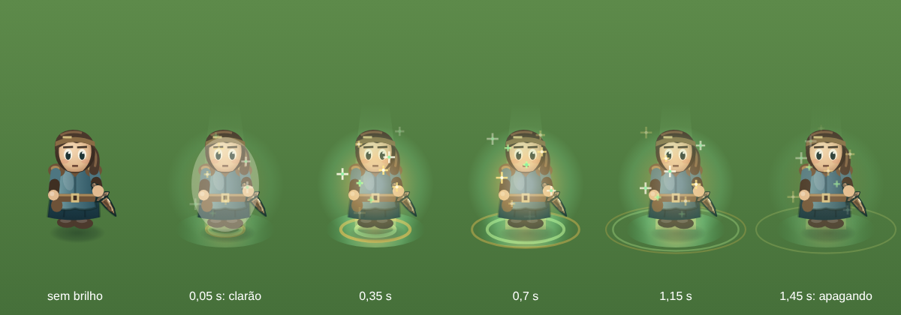

# ADR 0098 — Brilho de cura quando o herói usa a poção

**Estado:** entregue em 2026-11-27, a pedido do dono: "uma animação quando usa a poção de cura, um brilho, alguma coisa que acontece com o personagem".

## O que acontece
Ao usar a **poção de cura** (pelo botão da bolsa ou pela poção rápida) ou a **Poção Maior**, o herói brilha por **1,6 s**, na superfície e na caverna:
- **no chão** (por baixo do herói e da montaria): uma poça de luz dourada e verde, dois anéis que se abrem e somem e uma coluna de luz atrás dele;
- **por cima do herói**: uma aura dourada e verde que pulsa, com um **clarão** branco nos primeiros 0,2 s, e nove **faíscas em cruz** que sobem em volta dele. Montado, a aura sobe junto com a sela (`mountRiderLift`).
O brilho entra rápido e se apaga nos últimos instantes. O antídoto não brilha (não cura vida). Não acende se a poção não curou (vida cheia, sem poção, herói caído).

## Como é feito
- **`Player.healGlow`** (segundos que faltam, só apresentação, **não vai para o save**) desce em `advanceTimers` e nunca fica abaixo de zero. `HEAL_GLOW_SECONDS` (1,6) mora em `Player.ts`.
- **`usePotion` e `drinkElixir`** (só para elixires de cura) acendem o brilho depois de curar. O `ShopContext` ganhou `effectsEnabled` (opcional, padrão ligado) e o `Game` entrega `effects.enabled`: **com a opção de efeitos desligada o brilho não acende**.
- **`renderHealGlow(ctx, x, y, time, seconds, layer, lift)`** (`src/render/healGlow.ts`): uma função com duas camadas, `back` e `front`, porque o herói é desenhado entre elas. Sem sorteio nem relógio: o tempo vem por parâmetro e as faíscas saem de fórmulas por índice. Tempo vazio, vencido ou inválido não pinta nada.
- Ligado em `CanvasScene` (superfície) e `render/cave.ts` (caverna), na mesma ordem: chão, herói (e raízes, se enraizado), aura. Registrado no contrato de arte (categoria `prop`), sem baixar nenhum piso.

## Testes e mutações
`tests/heal-glow.test.ts` (7): a duração e a descida do tempo; a poção só acende quando cura e só com efeitos ligados (herói caído, vida cheia, sem poção, efeitos desligados); a Poção Maior brilha e o antídoto não; entradas inválidas não pintam; a estrutura de cada camada (poça, dois anéis, coluna, aura, nove faíscas, âncora nos pés, aura sobe com a montaria, chão não sobe); o clarão só no começo, a aura e a poça se apagando, as faíscas subindo, os anéis se abrindo; a ligação nas duas telas e no `Game`. 23 mutações (duração, descida, opção de efeitos, antídoto, cada camada em cada tela, faíscas, clarão, anéis, altura, entradas inválidas): nenhuma sobrevive.
