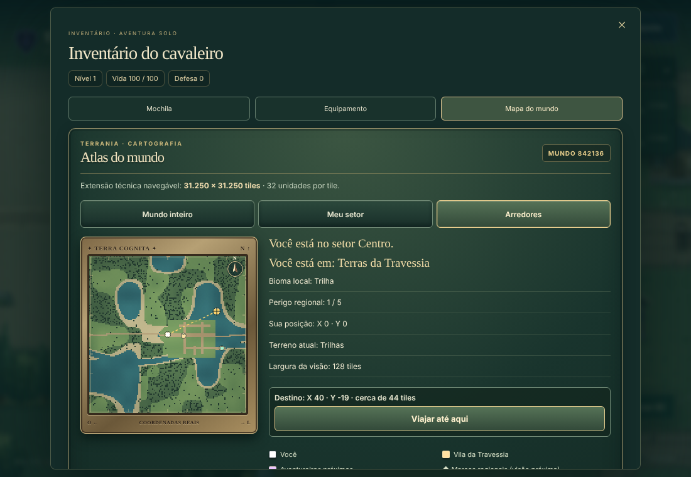
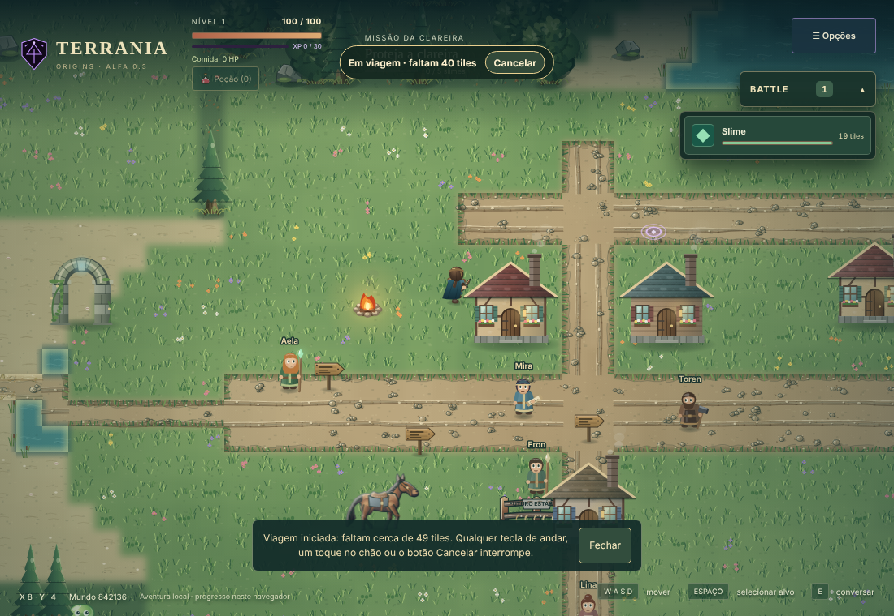

# ADR 0099 — Viagem pelo mapa: clicar no Mapa do mundo e o herói vai sozinho

**Estado:** entregue em 2026-11-27, a pedido do dono: "uma forma de andar clicando no mapa, isso ajuda a se locomover em grandes distâncias".

## O que existia
Tocar no chão já fazia o herói andar sozinho, mas só até uns 20 tiles (a busca de caminho `TapNavigator` é local: no máximo 650 unidades). O Mapa do mundo (atlas) mostrava o mundo, mas não era clicável.

## Como funciona agora
1. **Escolher:** no **Mapa do mundo** (qualquer escala: mundo inteiro, meu setor ou arredores) um clique marca o destino: aparece um **marcador dourado**, uma **linha tracejada** do herói até ele, e o painel mostra "Destino: X … · Y … · cerca de N tiles" com o botão **Viajar até aqui**. Trocar a escala mantém o destino (é uma posição do mundo). Dentro de caverna o mapa é a planta do andar e não escolhe destino.
2. **Viajar:** o botão fecha o mapa e a viagem começa. O destino que cai em água ou obstáculo vai para o **chão andável mais perto** (até 12 tiles); se não houver, o aviso pede outro ponto. Só vale **na superfície** e com o herói de pé; já a menos de 40 unidades do ponto, o jogo diz que você já está lá.
3. **Andar:** uma barra no topo da tela mostra "Em viagem · faltam N tiles" com o botão **Cancelar** (o mapa também mostra o progresso e tem o seu Cancelar).
4. **Parar:** ao **chegar** ("Você chegou ao destino."), ao **levar dano** ou ter uma **criatura a menos de 150 unidades** ("há perigo por perto"), ao **apertar uma tecla de andar**, **tocar no chão** ou escolher um alvo de combate (você assume o controle), ao **entrar em caverna ou casa**, ou quando **não há caminho** ("Não achei caminho até lá"). Montar e desmontar não interrompem.

## Como o herói acha o caminho
`Journey` (`src/engine/movement/Journey.ts`, sem tela nem rede, sem sorteio): a viagem é uma sequência de **trechos de até 560 unidades**, cada um um ponto que o navegador local sabe alcançar. A cada trecho ele testa candidatos (12 ângulos em volta da direção do destino, em 3 comprimentos) e fica com o que deixa o herói **mais perto do destino**, somado a um **custo por lugar já visitado** (memória por células de 8 tiles): quanto mais um lugar foi usado, mais caro ele fica, e a viagem acaba escapando de armadilhas (um lago em U, uma parede comprida). Desiste (sem caminho) quando **quatro trechos seguidos não saem do lugar** ou quando **30 trechos seguidos não chegam 32 unidades mais perto** do que já se chegou (destino cercado, ilha). O mesmo mapa e o mesmo ponto de partida dão sempre a mesma viagem.

`driveJourney` (`src/game/journeyDriver.ts`) é o quadro da viagem, separado do `Game` para ser testável: não pede trecho enquanto o navegador anda o atual, só escolhe trechos que o **navegador do jogo** consegue andar (por tiles, na superfície) e devolve `arrived`, `stuck` ou `danger`. `TravelState.journey` guarda a viagem: parar movimento ou mundo novo cancela; montar não.

## Testes e mutações
- `tests/journey.test.ts` (21): campo aberto (6 trechos para 3000 unidades, tempo quase em linha reta), parede com fresta, lago grande, armadilha em U, destino cercado desiste, sem trecho possível, falhas seguidas, ganho mínimo, a conta zera ao ganhar, trecho curto numa bolsa, memória de visitas e `cancel` que a apaga, determinismo, A* só pedido dentro de 650, `nearestWalkable`. A caminhada é de verdade (o `TapNavigator` real e `moveBody`).
- `tests/journey-driver.test.ts` (9), `tests/journey-wiring.test.ts` (5: a conta do clique em `atlasTileAt`, os avisos, a ligação no `Game`, no HUD e na tela).
- `tests/browser/journey.spec.ts` (4, desktop e Android): clicar no mapa e viajar até chegar (com aviso), cancelar pelo botão, cancelar por tecla, e o mapa sem destino.
- 44 mutações no motor, no quadro da viagem, no estado, no `Game`, no HUD e no mapa: nenhuma sobrevive. Duas foram descartadas como equivalentes: o atalho de "campo aberto" (o placar dos candidatos já impede mais buscas) foi **removido do código**, e a busca de trechos do quadro da viagem com ou sem andar por tiles só muda *quando* uma falha aparece (o navegador do jogo, no passo seguinte, recusa o trecho e a viagem desiste do mesmo jeito).

## Limites
O herói não desvia de criaturas nem de portas de caverna no caminho (a viagem para no perigo). Cavernas e casas não têm viagem pelo mapa. O mundo inteiro (31 250 tiles) leva muitos minutos a pé: a viagem funciona, mas é longa de propósito.
