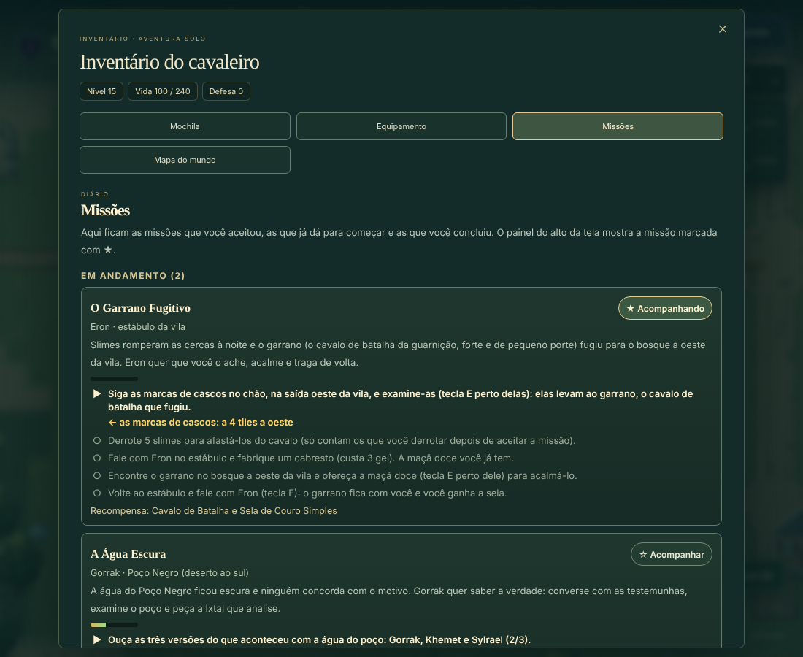

# ADR 0100 — Diário de missões e missão do Garrano em linguagem simples

**Estado:** entregue em 2026-11-27, a pedido do dono: "não entendi a missão da montaria do Eron (seguir os cascos, achar o garrano)", "uma missão concluída permanece na tela" e "deveria ter um inventário de missões, para saber quais o jogador já fez, quais está fazendo ao mesmo tempo e quais etapas".

## O que estava errado
- O painel do alto da tela mostrava **uma missão só** e, depois de concluída, **continuava mostrando** "Clareira protegida ✓" para sempre. A missão do Eron só aparecia no painel da Montaria, e a da Água Escura só no lugar da clareira.
- O texto da missão do Eron usava palavras como *garrano* e *marcas de cascos* sem explicar, e não dizia **onde** ir nem **o que apertar**.

## O diário (aba Missões, em Mochila → Missões)
Três grupos, nesta ordem: **Em andamento**, **Para começar** (dá para começar, mostrando o que falta: nível, estábulo, treino) e **Concluídas**. Cada missão é um cartão com título, quem a deu, a história em duas linhas, a barra de avanço, as **etapas** (✓ feita, ▶ atual, ○ próxima), a **recompensa** e, na etapa atual, um **guia de direção**: "→ as marcas de cascos: a 4 tiles a oeste" (oito ventos, norte para cima, distância em tiles em linha reta, "você está aqui" a menos de 2 tiles). Várias missões podem estar em andamento ao mesmo tempo; o botão **☆ Acompanhar** escolhe qual aparece no painel da tela.

As missões de hoje são **Proteja a clareira** (Aela: derrotar 5 slimes na Gruta dos Slimes e voltar a ela para as 2 poções), **O Garrano Fugitivo** (Eron: cinco etapas) e **A Água Escura** (Gorrak, no Poço Negro: quatro etapas). Cada uma tem o seu arquivo em `src/engine/quests/journal/` (`clearing.ts`, `warhorse.ts`, `well.ts`), mais `guide.ts` (o guia), `types.ts` e `index.ts` (`buildJournal`, `trackedEntry`, `questPanel`). O diário só **lê** o estado das missões (nada nele muda o jogo) e `Game.updateHud` o entrega ao HUD (`updateJournal`).

## O painel da tela
`questPanel` mostra a missão acompanhada **só enquanto está em andamento**: o título, a **etapa atual em uma frase curta** (até 48 letras, por exemplo "Derrote 5 slimes (2/5)"; o texto inteiro e o guia de direção ficam no diário, porque o painel é pequeno e já chegou a cobrir a lista de batalha no celular) e a barra. Com mais de uma em andamento, o rótulo diz "MISSÃO · +1 EM ANDAMENTO". **Missão concluída sai do painel** e vai para as concluídas do diário; sem nenhuma em andamento o painel diz "Nenhuma missão em andamento" e aponta o diário. O rótulo antigo fixo ("MISSÃO DA CLAREIRA") acabou.

## A missão do Garrano em linguagem simples
As cinco dicas (`world/mountQuests.ts`, usadas no diário, no painel e na aba Montaria) agora explicam: *o garrano é o cavalo de batalha que fugiu*; **siga as marcas de cascos no chão, na saída oeste da vila, e examine-as com a tecla E**; derrote 5 slimes (só contam os de depois de aceitar); fale com Eron no estábulo e fabrique o cabresto (3 gel); ache o garrano no bosque a oeste e ofereça a maçã (tecla E); volte a Eron. Os avisos ao começar e ao achar as marcas também mandam olhar o diário.

## Testes e mutações
`tests/quest-journal.test.ts` (10): o guia nos oito ventos e nos limites; a clareira (0, 3 e 5 mortes, com e sem recompensa, onde aponta); o Garrano do início ao fim passando pela missão de verdade (`MountStable`); a Água Escura por estado, com os mesmos percentuais do resumo antigo; a ordem do diário; o painel (escolhida, primeira, concluída sai, vazio); a ligação no `Game`, no HUD e na tela; os textos simples. `tests/browser/quest-journal.spec.ts` (4, desktop e Android): começo do jogo, clareira concluída sai do painel, duas missões e acompanhar, Garrano com guia. 46 mutações no motor, no painel, no HUD e na ligação: nenhuma sobrevive (duas só mostravam código sem uso: o singular "1 tile", que nunca acontece porque a menos de 2 tiles o guia diz "aqui", foi **removido**).

## Limites
O diário lista as três missões que existem hoje; missões novas entram com um arquivo novo em `journal/` e uma linha em `buildJournal`. O guia mostra a direção em linha reta (não contorna lagos); para ir longe, vale a [viagem pelo mapa](0099-viagem-pelo-mapa.md).
