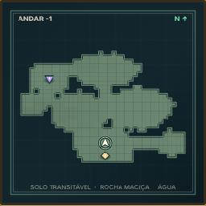

# ADR 0102 — Tocas laterais e atalhos na Masmorra das Raízes (L5b)

**Estado:** entregue em 2026-11-27, segunda fatia do pedido do dono para a Gruta das Raízes: "mais opções para andar na gruta, explorar coisas para fazer dentro da gruta". A primeira fatia foi o [ADR 0101](0101-toda-gruta-das-raizes-e-masmorra.md) (cinco andares); faltam os baús e a coleta que voltam (L5c) e um objetivo dentro da gruta (L5d).

## O problema
A planta de um andar era sempre uma **fila de cinco salas**, cada uma ligada só à próxima: um único caminho, sem desvio e sem motivo para sair dele.

## O que mudou (só nas grutas verdes do Centro)
- **Tocas:** salas pequenas fora da fila, cada uma ligada a uma sala principal por um corredor de 3 tiles, com um **guardião** no meio (uma criatura do povo do andar, id `…:den:N`). Quem foge do caminho encontra bicho, e as tocas são também o lugar das recompensas das próximas fatias. Há quatro posições no cardápio (*Toca Leste*, *Toca Noroeste*, *Toca do Telhado*, *Toca Sudoeste*), deslocadas em até 1 tile pelo sorteio da gruta. O andar 1 tem 2 tocas, o 2 tem 3 e do 3 em diante as 4.
- **Atalhos:** segundo corredor entre duas salas, para haver mais de um jeito de ir de um canto ao outro: nenhum no andar 1, um no 2, dois no 3 e três do 4 em diante.
- O guardião reaparece como qualquer criatura do andar (respawn do [ADR 0097](0097-respawn-dentro-do-andar.md)), no lugar onde nasceu e com o herói longe; derrotado, fica derrotado no save.
- A **gruta de treinamento da Aela** e as cavernas dos outros temas não mudam: a soma de verificação da planta delas é conferida no teste (valores tirados do código de antes).

## Onde está
`src/world/caveSideChambers.ts` (só geometria: posições, quantas por andar, atalhos), `CaveFloor` (escava as tocas e os atalhos; expõe `chambers` e `rooms`) e `CaveRoom.populate` (um guardião por toca). O corredor de 3 tiles ficou numa função só (`carveCorridor`), usada pela planta antiga e pelas novas, sem mudar o resultado.

## Testes e mutações
`tests/cave-side-chambers.test.ts` (12): contagens por andar; posições dentro da faixa segura e longe da saída e da escada; deslocamento do sorteio; a sala de cada toca; planta antiga intacta (soma de verificação da gruta de treinamento e de grutas de outros temas, andares 1 a 3); toda toca e a escada alcançáveis desde a saída em 40 grutas e todos os andares; corredor de cada toca e de cada atalho escavado de ponta a ponta; guardião no meio da toca, id próprio, derrotado que não volta no save e que volta onde nasceu. `tests/browser/cave-center.spec.ts` ganhou o mapa do andar da masmorra. 14 mutações (contagem, índice do atalho, sorteio em x e em y, treino virando masmorra, tema qualquer, sem corredor, sem atalho, sala sem escavar, toca ligada à sala errada, id e posição do guardião): nenhuma sobrevive; duas eram equivalentes (a checagem de "derrotado" na hora de povoar e o `if (plan)`) e o código redundante foi **removido**.

## Limites
O andar continua com 42 × 30 tiles (a planta é uma constante usada em dezenas de pontos), então as tocas e os atalhos aumentam os caminhos e o que há para encontrar, mas não o tamanho do mapa; planta maior fica para uma fatia própria. Em andares fundos, os atalhos deixam o miolo bem aberto. Os baús e a coleta nas tocas (L5c) e a missão (L5d) vêm a seguir.
