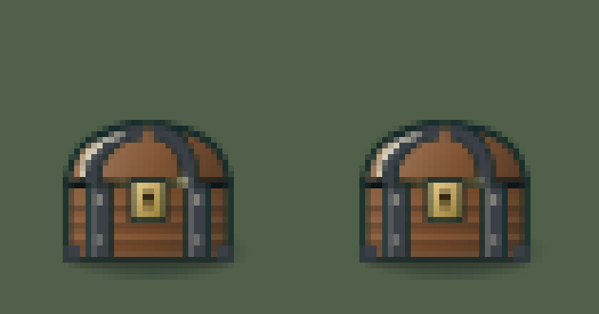

# ADR 0103 — Baús nas tocas da Masmorra das Raízes (L5c)

**Estado:** entregue em 2026-11-27, terceira fatia do pedido do dono para a Gruta das Raízes ("coisas para fazer dentro da gruta"). Antes vieram os [cinco andares](0101-toda-gruta-das-raizes-e-masmorra.md) e as [tocas e atalhos](0102-tocas-e-atalhos-da-masmorra-das-raizes.md); faltam a coleta que volta (matérias-primas para colher) e o objetivo da gruta (L5d).

## O que mudou
- **Cada toca tem um baú**, a dois tiles do guardião, no primeiro lado livre que o herói alcança. O baú só abre com o **guardião caído** e o herói a **menos de 30 px**: é o prêmio de quem fugiu do caminho e venceu o bicho.
- Abrir deixa **moedas no chão** (o herói as recolhe como as de qualquer criatura): 10 + 8 por andar em Terrania Gold, com variação de 80 % a 120 % sorteada pelo id do baú (o mesmo baú dá sempre a mesma quantia). Andar 1 paga cerca de 18; o 5, cerca de 50.
- O baú aberto vai para a **lista dos derrotados do save** (a mesma das criaturas, com o seu prazo de voltar), e **volta cheio em 15 minutos de jogo**, no mesmo lugar, quando o herói está a 170 px ou mais; a moeda que ficou para trás some junto. Ao reentrar na masmorra o baú nasce aberto ou fechado conforme o save.
- **Desenho novo** (`src/render/caveChestArt.ts`, peça `prop` no contrato de arte): caixa de madeira com tampa arqueada, duas cintas de ferro, fechadura de latão e um fio de ouro piscando na fresta. É a mesma em todo tema (o baú vem de fora), entra na mesma fila de profundidade das moedas e das criaturas.

## Onde está
`src/engine/rooms/CaveChests.ts` (regra pura: abrir, recompensa, voltar), `CaveRoom` (põe os baús ao povoar a toca, os atualiza e os devolve), `CaveRewards` (anota a abertura na simulação, como uma vitória), `respawn.ts` (o prazo do baú) e `CanvasScene.renderCave` (o desenho). `OfflineSimulation.noteDefeat` passou a aceitar id sem espécie.

## Testes e mutações
`tests/cave-chests.test.ts` (12): ids; moedas determinísticas e crescentes por andar; prazo de 15 minutos sem mexer nos outros prazos; abrir só a menos de 30 px e sem guardião, uma vez, com moeda no lugar do baú, com o chão cheio e com o save; baú alcançável, perto do guardião e com id próprio em 25 grutas e todos os andares; abrir pelo `CaveRoom` e pelo `tickCave` de verdade (a moeda entra na carteira e o baú fica salvo); voltar depois do prazo, no mesmo lugar, sem moeda esquecida; a tela desenha os baús fechados. A peça nova entrou em `tests/art-contract.test.ts`. 25 mutações (distância, guardião, fórmula e variação das moedas, anotação e save, teto de saque, prazo, posição, tela): nenhuma sobrevive; uma sobrevivia por usar a constante nos dois lados do teste e passou a conferir o número 30 de fato.

## Limites
Não há teste de navegador que abra um baú: ele fica numa toca, longe da entrada, e o jogo não permite pôr o herói lá por um save; a regra é conferida pelo `tickCave` real e o desenho, pelo contrato de arte e pela fila de profundidade. O baú só dá moedas; materiais para colher (coleta) e uma missão que use a gruta ficam para as próximas fatias.
