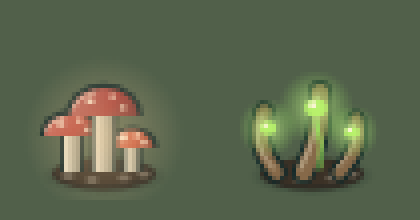

# ADR 0105 — Pontos de coleta na Masmorra das Raízes (L5e)

**Estado:** entregue em 2026-11-27, última fatia do pedido do dono para a Gruta das Raízes ("coisas para fazer dentro da gruta"): [cinco andares](0101-toda-gruta-das-raizes-e-masmorra.md), [tocas e atalhos](0102-tocas-e-atalhos-da-masmorra-das-raizes.md), [baús](0103-baus-das-tocas.md), a [missão da Raiz Velha](0104-a-raiz-velha.md) e agora a **coleta que volta**.

## O que mudou
- **Três pontos de coleta por andar**, em chão que o herói alcança, a 150 px ou mais da entrada, a 110 px ou mais da escada e a 120 px ou mais um do outro. O primeiro e o terceiro são **tufos de cogumelo** (dão Esporos de Cogumelo); o do meio é um **tufo de raízes com seiva** (Raiz Retorcida nos dois andares de cima, Seiva Viva dali para baixo). São os mesmos materiais que as criaturas do Centro deixam, e vendem-se do mesmo jeito.
- O herói **colhe ao chegar a menos de 28 px**, se a bolsa tem lugar para o material (a pilha é de 99); sem lugar, o ponto fica como está e nada se perde. O material vai direto para a bolsa e a tela avisa "Você colheu: …".
- O ponto colhido vai para a **lista do save** (a mesma dos derrotados e dos baús) e **brota de novo em 5 minutos de jogo**, no mesmo lugar, com o herói a 140 px ou mais.
- **Só a Masmorra das Raízes** tem pontos de coleta; a Cripta das Dunas e as outras cavernas não (um teste varre os outros temas: a primeira versão pôs cogumelo e raiz do Centro no deserto, e o teste pegou).
- **Desenho novo** (`src/render/caveHerbArt.ts`, duas peças `prop` no contrato de arte), com brilho que pulsa, na mesma fila de profundidade dos baús, das moedas e das criaturas.

## Onde está
`src/engine/rooms/CaveGathering.ts` (a regra: colher, voltar, onde e o quê), `CaveRoom` (põe os pontos ao povoar o andar e os atualiza), `CaveRewards.applyCaveGathering` (bolsa e save), `caveMode` (pergunta à bolsa a cada quadro, antes de a caverna andar; avisa e salva), `Inventory.canAddMaterial` e `CanvasScene.renderCave` (o desenho). Sem ligação com a bolsa a caverna não colhe nada, para o material nunca se perder.

## Testes e mutações
`tests/cave-gathering.test.ts` (11): ids, tipos e materiais (a bolsa aceita e as bancas compram); prazo de 5 minutos sem mexer nos outros; colher só a menos de 28 px e com lugar; espaço, save e volta; três pontos alcançáveis e afastados em 25 grutas e todos os andares; só a Masmorra das Raízes; sem ligação com a bolsa não colhe; pelo `tickCave` real (material na bolsa, pede para salvar, brota de novo); bolsa cheia; save entre andares; a tela. 35 mutações: nenhuma sobrevive, exceto duas equivalentes: o alcance a pé (a masmorra verde não tem ilhas hoje; o teste confere o resultado, e a guarda fica para plantas futuras) e a checagem `plan`, que era redundante e foi **removida**. `tests/helpers/caveModeHost.ts` ganhou a contagem de salvamentos.

## Limites
O material é sempre o mesmo por tipo e andar (nada de sorteio de raridade); não há ferramenta nem habilidade de coleta, e os materiais ainda não servem de ingrediente de receita: servem para vender. O ponto não tem nenhum teste de navegador (como os baús, fica longe da entrada); a regra roda no `tickCave` real e o desenho no contrato de arte.
