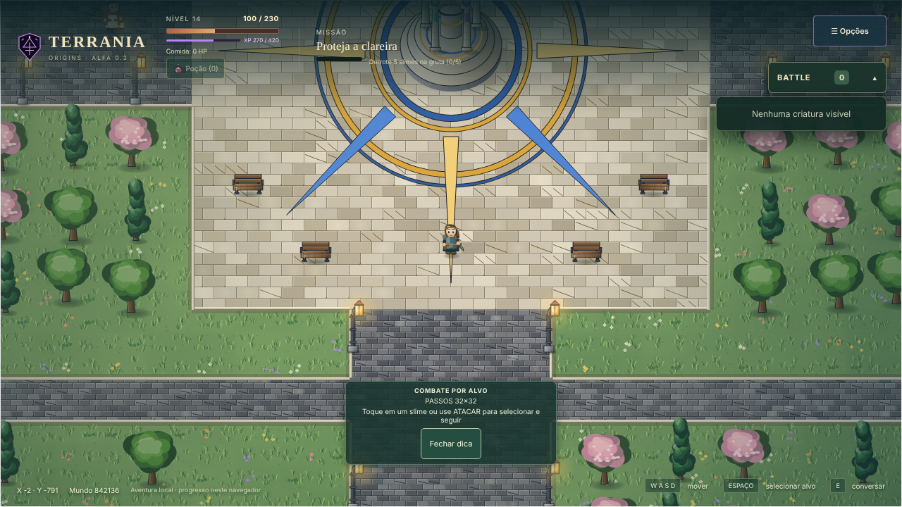

# ADR 0106 — Vida na capital: lampiões, bancos e árvores

**Estado:** entregue em 2026-11-27, primeira fatia da revisão da cidade central pedida pelo dono ("a cidade central não ficou muito boa"). Olhei a capital (Concórdia) e a Vila pelo jogo, em vários pontos e nos dois formatos de tela, antes de mexer.

## O que se viu
A capital tem boa arquitetura (muralha, portões, a praça, os oito edifícios), mas **13 dos 21 terrenos estão vazios**: retângulos de grama lisa entre as ruas, sem nada. Por decisão do dono (`docs/CAPITAL_EDIFICIOS.md`) **não se desenha edifício sem função de jogo**, então a saída não era construir às pressas. Faltava **vida**: nada nas ruas, nada na praça, nenhum verde que parecesse de propósito.

## O que mudou (sem criar edifício algum)
- **Árvores nos terrenos vazios:** uma grade a cada 3 tiles, a 2 tiles das bordas, com o pé deslocado até 0,3 tile por posição (69 árvores), em três espécies: **carvalho** de copa redonda, **cipreste** alto e **cerejeira** em flor. Só o **tronco bloqueia** (círculo de 9 px no pé): a copa não, e as ruas seguem livres. Quando um terreno ganhar edifício (`CAPITAL_BUILT`), as árvores dele **somem sozinhas**: a regra é derivada da lista.
- **28 postes de lampião** com a lanterna acesa nas bordas da Grande Avenida e da Avenida dos Povos, fora da praça e dos cruzamentos (não bloqueiam: ficam no meio-fio).
- **8 bancos de praça** em volta do monumento, de frente para ele.
- Tudo sai da planta (só `hash2` por posição): igual em toda semente e em toda tela. Peças novas no contrato de arte (`props/lamp.ts`, `props/bench.ts`, `props/tree.ts`), no cadastro de cenário da capital e na colisão (`capitalDecorBlocks`).

## Testes e mutações
`tests/capital-decor.test.ts` (7): contagens e ids; árvores só nos terrenos sem edifício, dentro da grade, fora de rua e de edifício, com as três espécies; lampiões dentro da muralha, fora da praça e dos edifícios; bancos na praça; só o tronco bloqueia (raio, borda, valores inválidos); colisão do jogo; o desenho e a derivação de `CAPITAL_BUILT`. Quatro testes antigos da capital foram atualizados para a nova lista de peças e para o tronco como único obstáculo nos terrenos vazios. Navegador (desktop e Android): `center-capital-decor.spec.ts` (flores de cerejeira e vidro dos lampiões aparecem na tela; o herói para diante do pé de uma árvore). 18 mutações: nenhuma sobrevive útil; uma é equivalente (a rejeição rápida de longe, que só poupa trabalho).

## Limites e próximos passos da revisão
Os terrenos vazios continuam sem função: viraram parques até a decisão do dono sobre o que cada um será. Da revisão ainda faltam: a **Vila da Travessia** (a faixa oeste de areia com lagos quadrados e bordas retas parece um bloco, não uma costa), gente andando pelas ruas da capital e a jogabilidade (distâncias entre os serviços). Nada disso foi mexido aqui.
