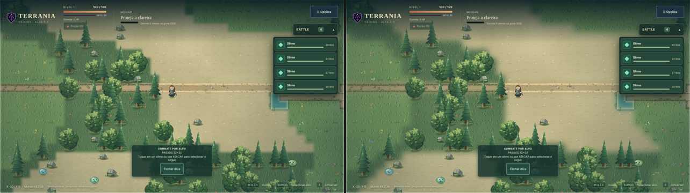

# ADR 0107 — Transição suave entre os solos (fim dos degraus de tile)

**Estado:** entregue em 2026-11-27, segunda fatia da revisão da Vila e da capital pedida pelo dono. Ao olhar a Vila da Travessia pelo jogo, o que fazia o campo parecer "de blocos" não eram os edifícios: era o **chão**.

## O que se viu
Cada tile do chão é uma cor lisa (mistura de uma sombra e uma luz por ruído). Entre dois tiles de solos diferentes (mata, grama, areia) o encontro era só um **desfoque de 4 px**, pequeno demais: sobravam **degraus retos de tile** e retângulos escuros no meio do campo, e as bordas de uma mancha de mata pareciam recortadas com régua.

## O que mudou
O desfoque do chão passou de 4 para **11 px** (`GROUND_BLEND_PX` em `src/render/terrain.ts`, uma constante só). O degrau vira um degradê macio e arredondado; o resto do desenho (estradas, detalhes, lago, piso da cidade, edifícios) é pintado depois e não muda. O desfoque cabe na folga de **um tile (32 px)** que cada chunk pinta além da borda (a mesma que já evita costura entre chunks), e custa uma troca de filtro por chunk: o orçamento de operações e degradês do chunk não muda e o tempo de desenho do chunk ficou igual no teste de navegador.

Conferi também o deserto (Poço Negro e costa leste), o norte e a capital: as transições de areia, dunas e piso saíram igual ou mais macias, sem costura entre chunks.

## Testes
`tests/terrain-ground-blend.test.ts` (3): o valor é 11 e fica entre 8 px (abaixo disso os degraus voltam) e um tile (acima disso aparece costura); o chunk liga esse desfoque e o desliga em quatro lugares (vila, mata, capital, deserto); e o valor sai de uma constante só. Mutações: voltar a 4 px e tirar o desfoque são pegas. O `chunk-time.spec` e a suíte de navegador inteira passam.

## Limites
O desfoque suaviza as bordas, mas a *forma* das manchas segue sendo a da grade de tiles (uma mancha de mata ainda tem contorno de quadrados, só que macio). Contorno orgânico de verdade (ruído deslocando a borda) e as lagoas pequenas de borda reta ficam para uma próxima fatia, assim como moradores andando pelas ruas da capital.
