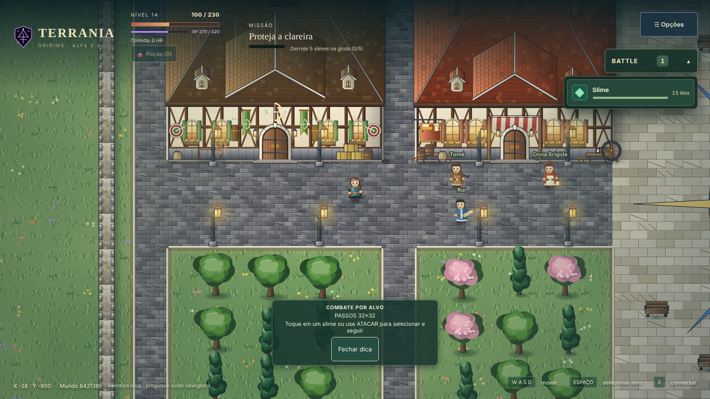

# ADR 0108 — Moradores andando pelas ruas de Concórdia

**Estado:** entregue em 2026-11-27, terceira fatia da revisão da Vila e da capital pedida pelo dono. A capital já tinha árvores e lampiões (ADR 0106), mas as ruas seguiam **vazias**: só os moradores com função (hospedeira, banqueiro, sacerdotisa, mestre da Academia) estavam parados na porta.

## O que mudou
Oito moradores **sem função de jogo** passaram a ir e voltar pelas ruas, cada um em um trecho próprio. Só conversam (duas falas cada, curtas e com um assunto da cidade), de acordo com a regra do dono "só entra quem tem função": eles não abrem loja, nem missão, nem edifício.

| Morador | Papel | Onde anda (tiles a partir do centro da Praça) |
|---|---|---|
| Tomé | Remendão | a oeste da Praça (ponto de origem −26, −1), 6 tiles para cada lado, na horizontal |
| Dona Cecília | Mercadora | a leste (28, 1), 5 tiles na horizontal |
| Rui | Aprendiz | a oeste (−17, 1), 3,5 tiles na horizontal |
| Marta | Guarda da muralha | a leste (17, −1), 3,5 tiles na horizontal |
| Bento | Carregador | Grande Avenida ao norte (−2, −22), 5 tiles na vertical |
| Inês | Cantora | avenida ao sul (2, 21), 4 tiles na vertical |
| Olavo | Ancião | ao norte da Praça (−3, −9), 2 tiles na vertical |
| Clara | Jardineira | ao sul (8, 15), 8 tiles na horizontal |

Um arquivo por morador em `src/npcs/center/capital/citizens/` (ficha, aparência, falas e rota), e um `index.ts` que junta tudo; `src/npcs/center/capital/index.ts` entrega os oito a `CAPITAL_NPCS`, `CAPITAL_NPC_LOOKS` e `CAPITAL_NPC_DIALOGUES`.

## Como andam
A caminhada que já existia (`npcPositionAt`, um vai e vem senoidal) ganhou só uma **fase** opcional: `phase` adianta o passo de cada morador para que **não andem todos juntos**. Quem não tem fase (Mira, Toren, Lina, os do Sul, Aela) anda exatamente como antes, e a rota dos moradores é escrita em **tiles** e convertida para pixels no catálogo.

Todas as rotas ficam **só em rua**, dentro da muralha, longe do monumento e dos edifícios, em qualquer ponto do ciclo: o teste amostra o ciclo inteiro de cada um.

## Testes
`tests/capital-citizens.test.ts` (6): oito moradores com ids, nomes e papéis únicos, aparência e duas ou mais falas; o ciclo inteiro da rota só pisa em rua e fora do monumento e dos prédios; o percurso é o da rota, eles param nas pontas e as fases são diferentes; os NPCs de antes seguem iguais; conversar perto funciona e longe não; o catálogo junta as rotas. Mutações: tirar a fase, não converter tiles em pixels e errar o eixo vertical são pegas. `tests/browser/capital-citizens.spec.ts` (desktop e Android, relógio parado): Tomé conversa no começo da rota e, 5 s de jogo depois, já andou para longe e o botão de conversa some.

## Limites
Andam em linha reta de ida e volta; não desviam do herói nem têm horário (dormir, abrir a loja). Passeios mais ricos (ruas em laço, paradas, a cantora na praça à noite) e moradores nos terrenos vazios dependem das funções que o dono definir.
