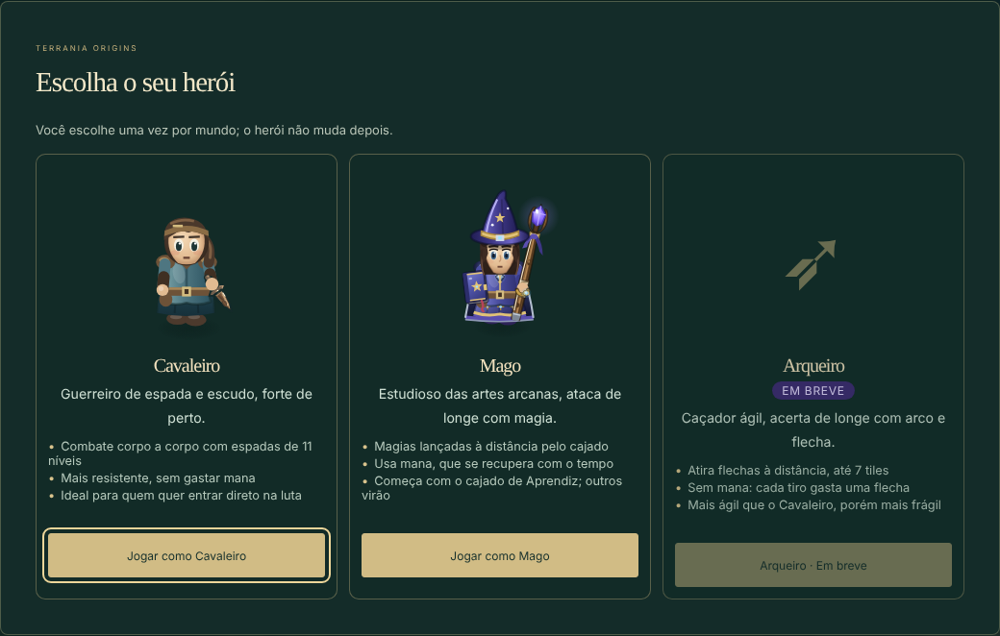

# ADR 0109 — O Arqueiro entra como vocação (lote A1a: ficha, vida e agilidade)

**Estado:** entregue em 2026-11-28, primeira fatia do Arqueiro de [ARQUEIRO.md](../ARQUEIRO.md). O lote A1 do plano (vocação, primeiro arco, flechas e disparo) é grande demais para uma entrega só; foi cortado em fatias pequenas, como se fez com o Mago. Esta é a **A1a**: o Arqueiro passa a **existir** no motor e aparece na tela de escolha, **bloqueado ("Em breve")**.

## O que mudou
- **A ficha** (`src/engine/character/classes/archer.ts`): nome Arqueiro, **sem mana**, **85% da vida** do Cavaleiro no mesmo nível (`ARCHER_HP_PERCENT`), **10% mais ágil** (`ARCHER_SPEED_PERCENT = 110`), não usa espadas, veste roupas, `playable: false`. Os números são as propostas do dono em `ARQUEIRO.md`; ajustam-se nesse arquivo.
- **Os espaços** do inventário, com nomes próprios: Capuz, Colar, Anel, Gibão, **Arco**, **Luvas** (no lugar do escudo), Calça, **Flechas** e Botas. **Sem mochila.** Ainda não aparecem em jogo (ninguém joga de Arqueiro), mas já estão definidos.
- **A agilidade** vale de verdade no motor: a ficha ganhou `speedPercent` (100 no Cavaleiro e no Mago) e o `Player` ganhou `speedScale`, que multiplica o `movementMultiplier`, a mesma conta que a superfície (passo por tile) e a caverna (movimento livre) já usam. Ela acompanha o herói ao entrar e sair da caverna (`syncAdventureStateFrom`) e depois de renascer; lentidão e congelamento continuam valendo por cima. Não é salva: vem sempre da ficha.
- **A tela de escolha** mostra três cartas (o Arqueiro com o selo "Em breve", botão desligado, os três traços do papel e um **➶** no lugar do desenho, que só vem no lote A2). A janela ficou mais larga (três colunas no desktop; duas até 900 px; uma no celular).

## Por que bloqueado
Faltam o arco, as flechas, o disparo, o desenho e o inventário. Liberar agora daria um herói que não consegue atacar. O mesmo caminho do Mago (ADR 0066/0072): a vocação existe, a tela a mostra como "Em breve" e ela só é liberada ao ficar completa. Um save escrito à mão com `"heroClass":"archer"` é aceito como vocação conhecida (como era com o Mago), mas ninguém o gera pelo jogo.

## Testes
`tests/archer-class.test.ts` (6): a ficha (nome, sem mana, 85/110, não jogável); os nove espaços e seus nomes, sem mochila; a vida em cinco níveis, entre a do Cavaleiro e a do Mago; o herói Arqueiro anda 10% mais no mesmo tempo (o Mago, igual) e a lentidão segue valendo; a velocidade vai e volta da caverna e sobrevive a renascer; o cartão bloqueado e o ➶. Ajustados `hero-classes` e `hero-select` (três vocações, a terceira bloqueada). Mutações pegas: 85→90, 110→100, `playable: true`, esquecer de copiar a velocidade para a caverna, esquecer de aplicá-la no começo ou ao renascer, pôr mochila, trocar "Gibão". `tests/browser/hero-select.spec.ts` (desktop e Android) confere o cartão bloqueado.

## O que vem depois
A1b: o primeiro arco (Arco de Caça) e as flechas de junco no motor, com alcance de 7 tiles e preparo do disparo; A1c: o disparo na superfície e na caverna, o projétil e o inventário; só então o Arqueiro é liberado. Depois seguem A2 a A6 de `ARQUEIRO.md`.
