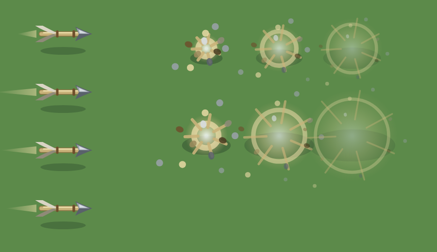

# ADR 0112 — A flecha que voa e o impacto (Arqueiro, lote A1c-2)

**Estado:** entregue em 2026-11-28, quarta fatia do Arqueiro de [ARQUEIRO.md](../ARQUEIRO.md) (depois dos ADR [0109](0109-arqueiro-a1a-vocacao.md), [0110](0110-arqueiro-a1b-arco-e-flechas.md) e [0111](0111-arqueiro-a1c-o-tiro.md)). Agora o tiro **se vê**: a flecha sai das mãos do herói, voa até o alvo e, ao chegar, mostra o impacto e o número do dano. O Arqueiro continua bloqueado ("Em breve") na tela de escolha até o A1c-3.

## O que mudou
- **A flecha** (`src/render/arrows/arrow.ts`): haste de junco seco, ponta de pedra lascada com amarração, duas penas de ganso abertas para trás, sombra no chão e um rastro de vento que se estica no começo do voo e some perto do alvo. Sem sorteio: o mesmo quadro sai igual em teste e captura.
- **O impacto** (`hit.ts`): sopro de poeira, anel curto, lascas e faíscas que caem; menor e mais seco que o estouro da magia. O do tiro que **derruba** o alvo é 1,5 vez maior e dura mais (0,46 s contra 0,30 s).
- **O voo** (`ArrowFlights.ts`): como o `SpellBolts` do Mago, descobre o tiro pela queda de vida do monstro durante o disparo (ou pelo monstro que some, se a vida que tinha cabia no tiro e estava ao alcance, com 8 px de folga) e só atrasa o que se vê: o dano já foi aplicado pela simulação. A flecha sai **10 px à frente e 14 px acima** do herói (nas mãos), voa a 900 px/s (de 0,06 a 0,26 s, mais lenta que a magia: dá para ver a flecha) até o **peito** do alvo (12 px acima dos pés) e, ao chegar, vira o impacto e um número "−8" cor de palha (maior quando o dano passa de 1). No máximo 12 flechas, 16 impactos e 16 números ao mesmo tempo. Com os efeitos desligados só a flecha aparece.
- **Sem fiação nova:** o `SpellBolts` agora carrega um `ArrowFlights` (`spells.arrows`) e repassa atualizar, desenhar, limpar e ligar/desligar; como a superfície (`Effects`) e a caverna já usam o `SpellBolts`, as flechas aparecem nas duas sem tocar nos modos. `Effects` passou a tratar o tiro como golpe à distância (nada de clarão de espada junto da flecha).

**Contrato de arte:** as três peças (a flecha, o impacto e o impacto de quem cai) estão registradas em `tests/helpers/artAssets.ts` no nível "prop" e, para cumprir os pisos sem baixar nenhum deles, a flecha ganhou ponta e penas curvas e o impacto ganhou sombra no chão, torrões de terra e lascas de pedra com cores variadas.

## O que não está nesta fatia
A **pose de atirar** (arco nas mãos, braço que estica e puxa a corda) e o **corpo próprio do Arqueiro** ficam para o lote **A2** do plano, juntos, porque a pose só faz sentido com o corpo e o arco desenhados. Até lá o Arqueiro (bloqueado) ainda usa o corpo do Cavaleiro na tela. Mudei o plano do ADR 0111 de acordo: o A1c-2 é só a flecha e o impacto.

## Testes
`tests/archer-arrow-render.test.ts` (10): a flecha e o impacto desenhados (cores, partes, mudam com o progresso, entradas ruins); a flecha sai só quando a vida do alvo cai durante o tiro (nem na primeira vez que o vê, nem sem queda, nem cura, nem fora do tiro, nem com espada ou magia); o alvo que some dentro do alcance com vida até o dano do arco também recebe a flecha, e o limite de 8 px de folga; o voo (sai das mãos, mínimo e máximo, impacto no peito, número, tempos); o impacto maior de quem cai e o número pequeno para dano 1; o corte de 12/16/16; efeitos desligados e reset; a passagem pelo `SpellBolts` com a magia do Mago intacta; e o `Effects`. **Mutações:** 31 tentadas; 21 pegas na hora, 8 pediram teste novo (o peito do alvo, o mínimo e o máximo do voo, o impacto maior de quem cai, o número grande, o limite de flechas e os de impactos e números, o esquecer do monstro visto no reset) e todas passaram a ser pegas; uma proteção contra posição inválida se mostrou redundante (a flecha de posição inválida já era descartada no mesmo quadro) e foi removida.

## O que vem depois
A1c-3: o espaço Flechas do inventário mostra a quantidade e o tipo, e o Arqueiro é liberado na tela de escolha. Depois A2 (corpo, arco e pose de atirar), A3 (tipos de flecha e a compra na Irmandade), A4 a A6.
