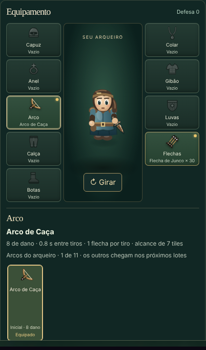

# ADR 0113 — O Arqueiro no inventário e nas lojas (lote A1c-3)

**Estado:** entregue em 2026-11-28, quinta fatia do Arqueiro de [ARQUEIRO.md](../ARQUEIRO.md) (depois dos ADR [0109](0109-arqueiro-a1a-vocacao.md) a [0112](0112-arqueiro-a1c-a-flecha-que-voa.md)). O inventário e as lojas passam a entender o Arqueiro. **A liberação na tela de escolha não entrou aqui** (veja "Por que ainda bloqueado").

## O que se via de errado
O jogo decidia muita coisa por "quem não usa espada é o Mago": o painel da arma mostrava **cajados** (o Arqueiro veria o Cajado de Aprendiz), a Mestra da Academia lhe ofereceria o Cajado da Brisa e as lojas de cajado aceitariam o pedido dele. Isso era certo com duas vocações e passou a ser errado com três.

## O que mudou
- **O tipo de arma na ficha** (`HeroClassSheet.weapon`: `"sword"`, `"staff"` ou `"bow"`): Cavaleiro espada, Mago cajado, Arqueiro arco. O resto do jogo passou a decidir por ele: a Academia só oferece cajado a quem luta com cajado, comprar ou equipar cajado só vale para o Mago, e o painel de cajados do inventário só aparece para o Mago. Espada continua só para quem tem `usesSwords`.
- **As mensagens de recusa** dizem de quem é cada arma e o que as outras vocações usam: "Espadas são para o Cavaleiro: o Mago luta com cajado e o Arqueiro, com arco." e "Cajados são para o Mago: o Cavaleiro luta com espadas e o Arqueiro, com arco." (os testes antigos que conferem "Mago" e "cajado" seguem valendo).
- **O inventário do Arqueiro** (`hud.service`, `game-page.html`): o título é "Inventário do arqueiro"; os **nove espaços** com os nomes dele (Capuz, Colar, Anel, Gibão, Arco, Luvas, Calça, Flechas e Botas, sem mochila; a frase de acessibilidade diz "Nove espaços"); o espaço **Arco** mostra o Arco de Caça com o ícone de arco, e ao clicar abre o painel do arco (8 de dano, 0,8 s entre tiros, 1 flecha por tiro, alcance de 7 tiles, "1 de 11"); o espaço **Flechas** mostra "Flecha de Junco × 30" (ou "Vazio" sem flechas), e ao clicar abre a **aljava**: total de flechas, a regra (cada tiro gasta uma, no máximo 99 de cada tipo) e a contagem por tipo.
- **O ícone do arco** (`bow-hunting`, no estilo dos outros ícones: contorno escuro, cores planas, 32 × 32): um arco curvo de freixo com a corda e uma flecha encaixada. Cada arco novo ganhará o seu `bow-<id>`.
- **O caminho dos dados:** o HUD recebe o arco em mãos (`equippedBow`) com os dados do herói e a aljava (`updateQuiver`) com a bolsa, no mesmo ritmo que o cajado.

## Por que ainda bloqueado
Falta o **corpo do Arqueiro** e a **pose de atirar** (lote A2): hoje, na tela, o herói Arqueiro ainda teria o corpo do Cavaleiro e "bateria" com um golpe de espada; a prévia do inventário também mostra esse corpo. Liberar agora daria um personagem que não parece nem se move como Arqueiro. Quando o A2 chegar, o Arqueiro é liberado na tela de escolha (é só virar `playable`). Até lá o inventário dele pode ser visto por um save com `"heroClass":"archer"`, que é como o teste de navegador o abre.

## Testes
`tests/archer-inventory.test.ts` (5): o tipo de arma de cada vocação; o Arqueiro não compra nem equipa espada nem cajado, e nem o ferreiro nem a Mestra da Academia lhe oferecem nada (sem mudar o mundo dele), com o Mago e o Cavaleiro como antes; as duas mensagens; o ícone do arco; a fiação (HUD, jogo, interface e os três painéis da tela, sem nenhum "não usa espada" restante). Ajustados os testes do Mago que olhavam o código de decisão por espada. `tests/browser/archer-inventory.spec.ts` (3, desktop e Android): os nove espaços e nomes, o arco e a aljava com 30 flechas, o painel do arco (sem cajados nem espadas), o painel da aljava, e a aljava com 7 flechas e vazia vindas do save. Mutações pegas (nove): o tipo do Arqueiro e do Mago, cada recusa de cajado, a oferta da Academia, o ícone do arco, o espaço das flechas, a mensagem e a entrega da aljava ao HUD.

## O que vem depois
A2: o corpo do Arqueiro (rosto anguloso, cabelo preso, capuz, aljava às costas), o arco nas mãos e a pose de atirar; em seguida a liberação na tela de escolha. Depois A3 (tipos de flecha e a compra na Irmandade), A4 a A6.
