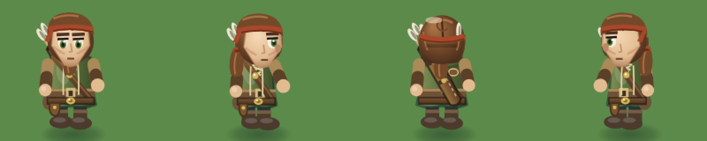

# ADR 0114 — O corpo do Arqueiro (lote A2a)

**Estado:** entregue em 2026-11-28, sexta fatia do Arqueiro de [ARQUEIRO.md](../ARQUEIRO.md). O lote A2 do plano (o desenho do personagem e a pose de atirar) foi cortado em dois: **A2a (esta)** o corpo, **A2b** o arco nas mãos e a pose de atirar, e só então a liberação na tela de escolha. Por isso o Arqueiro segue bloqueado ("Em breve").

## O que mudou
O herói Arqueiro deixa de aparecer com o corpo do Cavaleiro. Ele ganha uma aparência própria (`src/render/hero/archer/`), no mesmo caminho do Mago (`HeroLook`: o corpo, o andar e a respiração são os de todos os heróis; a aparência troca o que se veste), com um arquivo por assunto:
- **A cabeça** (`head.ts`, com `body/face.ts`, `body/hairBack.ts`, `body/hairFront.ts`): rosto **anguloso** (maçãs do rosto marcadas, queixo em ponta, olhos verde-avelã de pálpebra pesada, sobrancelhas retas e grossas que descem ao golpear), **cabelo castanho-avermelhado curto** com franja em pontas e um **rabinho preso** que balança com o passo, e a **faixa vermelho-ferrugem** atada na testa, com o nó caindo de lado e uma **pena de ganso** enfiada nela. O rosto pisca, franze e grita como o dos outros heróis. De costas, o couro cabeludo com o redemoinho e a faixa.
- **A aljava** (`quiver.ts`), no lugar do manto: um cilindro de couro inclinado, preso por correia, com as flechas (hastes de junco e penas) à mostra pela boca. De frente, o corpo esconde a parte de baixo e só a boca com as penas aparece acima do ombro de trás; de costas, a aljava inteira cruza as costas. Balança de leve com o passo.
- **O tronco** (`torso.ts`): a gola em V fechada por **cordões cruzados**, a **correia da aljava** que cruza o peito (com fivela), o **cinto** com fivela e a **bolsinha** de couro no quadril; de costas, a costura da coluna, o remendo na omoplata e os rebites.
- **As cores** (`palette.ts`): gibão de couro cru verde-musgo, braçais de couro escuro, correias e aljava em três tons de couro, fivelas douradas; a pele é a mesma dos outros heróis.
- **No desenho do herói** (`actors.ts`), o Arqueiro usa `archerWear` (no formato do `MageWear`, com tudo nulo menos a aparência: ele ainda não tem peças avulsas, lote A6). Como o arco ainda não está desenhado, **nada é desenhado na mão dele** (`bowman`); sem isso o desenho do Mago seguraria um cajado na mão do Arqueiro.

Sem barra de túnica e sem capuz por enquanto: o capuz vem com os conjuntos altos (lote A6), como o chapéu do Mago.

## Contrato de arte
As sete peças (cabeça de frente, de lado e de costas, aljava de frente e de costas, tronco de frente e de costas) estão registradas em `tests/helpers/artAssets.ts` no nível "prop" e cumprem os pisos sem baixar nenhum. Os desenhos foram enriquecidos até cumprir (por exemplo, a pena e a sombra da nuca na cabeça de costas, o remendo e as costuras no tronco), e conferidos numa captura ampliada.

## Testes
`tests/archer-body.test.ts` (9): a aparência (cores, cabeça, aljava no lugar do manto, sem barra nem capuz); o que ele veste (sempre a mesma aparência, sem peças de Mago); a cabeça (cores, rosto só de frente e de lado, três desenhos diferentes, um olho só de lado, o cabelo de trás pintado antes); o cabelo (rabinho e nó balançam, de costas e de lado mudam, a faixa e a pena de costas); a reação do rosto; a aljava (de frente e de costas, balança, acompanha a largura de perfil); o tronco (cordões, correia, cinto, o que é só de frente e só de costas); o herói inteiro (outro desenho que o do Cavaleiro e o do Mago, usa as cores dele, não mostra espada nem cajado, quatro direções, dano e andar); e a fiação em `actors.ts`. **Mutações:** 18 tentadas; 12 pegas na hora e 6 pediram teste novo (o cabelo de trás, o olho único de lado, o balanço do rabinho e do nó, a gola só de frente, a pena de costas), todas passaram a ser pegas; uma mutação de geometria sem efeito de comportamento (mais um ponto no queixo) foi descartada como equivalente.

## O que vem depois
A2b (feito no [ADR 0116](0116-arqueiro-a2b-arco-e-pose.md)): o **arco nas mãos** (desenho do Arco de Caça em repouso, a pose de atirar com o braço da frente esticado e a mão de trás puxando a corda no preparo, a flecha encaixada) e o corpo do Arqueiro na tela de escolha; a liberação ficou para depois do A3 (comprar flechas). Depois A3 (tipos de flecha e a compra na Irmandade), A4 a A6.
