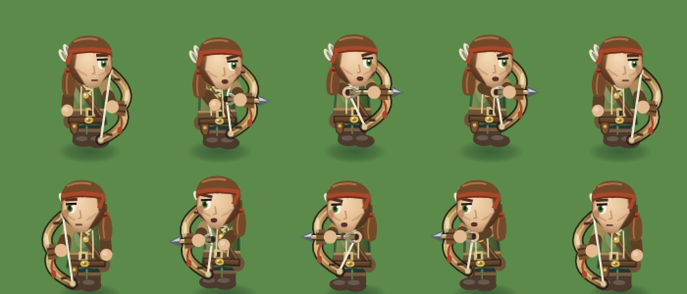

# ADR 0116 — O arco nas mãos e a pose de atirar (lote A2b)

**Estado:** entregue em 2026-11-28, sétima fatia do Arqueiro de [ARQUEIRO.md](../ARQUEIRO.md), depois do corpo ([ADR 0114](0114-arqueiro-a2a-corpo.md)). Agora o Arqueiro **segura o arco** e **atira de verdade na tela**. Ele segue bloqueado ("Em breve"): a liberação ficou para depois do A3 (comprar flechas), veja "Por que ainda bloqueado".

## O que mudou
- **O arco desenhado** (`src/render/bows/bow.ts`): arco curvo de freixo (cores da `visual` da ficha do arco, então cada arco novo já ganha a dele), empunhadura de couro com duas cintas, cintas perto das pontas, brilho na barriga, **borla de fio vermelha** pendurada (a mesma cor da faixa do herói) e a **corda**: esticada de ponta a ponta no repouso; puxada, ela recua em ponta e as pontas do arco cedem um pouco. A **flecha encaixada** (`nock.ts`) só aparece com a corda puxada: o fundo com as penas fica na corda e a ponta de pedra passa da barriga do arco.
- **A pose** (`bowMount` em `heroPose.ts`), com as mesmas fases do preparo e da saída que o Mago usa (`castPhase`): em **repouso** o arco vai ao lado do corpo, quase em pé; no **preparo** o braço do arco **ergue e estica** para o alvo na altura do ombro e a **mão livre sobe até a corda e a puxa** até perto do queixo; na **saída** a corda solta e o braço volta ao repouso sem salto. Para a esquerda é o espelho (a barriga do arco aponta para onde o herói mira; de frente ou de costas, para o lado da mão que o segura). O corpo recua um pouco no preparo e avança na saída, como na conjuração.
- **Sem fiação nova no jogo:** o herói já passava `attackBow` e `attackWindup` do `Player`; o desenho do herói (`renderHero`) escolhe o arco no lugar do cajado e da espada para o Arqueiro (o ADR 0114 só reservava o lugar), e a flecha que voa do ADR 0112 sai de perto dessa mão.
- **O corpo dele na tela de escolha:** o cartão do Arqueiro deixa o ➶ e mostra o herói de frente com o arco ao lado e a aljava às costas, como o Cavaleiro e o Mago.

## Contrato de arte
O arco em repouso, o arco com a corda puxada e a flecha encaixada estão em `tests/helpers/artAssets.ts` (nível "prop"), cumprindo os pisos sem baixar nenhum; para isso os desenhos ganharam as cintas, o brilho, a borla, o degradê da haste e os detalhes das penas. As poses foram conferidas numa captura ampliada, nas quatro direções.

## Por que ainda bloqueado
O Arqueiro já tem corpo, arco, tiro, flecha que voa e inventário, mas **só 30 flechas e nenhum jeito de repor**: a compra na Irmandade dos Arqueiros é o lote A3. Liberar agora daria um herói que fica sem munição e sem saída. Ordem: **A3 (comprar flechas) e então a liberação na tela de escolha.**

## Testes
`tests/archer-bow-render.test.ts` (6): o arco em repouso (lado, inclinação, balanço); a pose no tiro (início, meio, puxada cheia, espelho à esquerda, de frente, soltura e volta sem salto, com as posições do braço e da mão da corda); o arco desenhado (cores da ficha, flecha só com a corda puxada, entradas ruins); o tom do quadro nas cores e a flecha encaixada; o herói inteiro (cada momento do tiro é um desenho, as quatro direções, o cajado e a espada não aparecem, o preparo da ficha manda no tempo); e a fiação. Ajustados `archer-class` e o teste de navegador da escolha (agora o cartão mostra o corpo do Arqueiro). **Mutações:** 14 tentadas e todas pegas (o lado da barriga, a soltura, a corda, a altura de mira, a inclinação, a borla, o espelho, o arco na mão, a mão que puxa a corda, a flecha encaixada).

## O que vem depois
**A3:** os tipos de flecha e a **compra na Irmandade dos Arqueiros** (porta, interior, mestre e preço em Terrania Gold), com a munição no inventário; **então a liberação** do Arqueiro na tela de escolha. Depois A4 (os dez arcos), A5 (habilidades) e A6 (os onze conjuntos de roupa).
