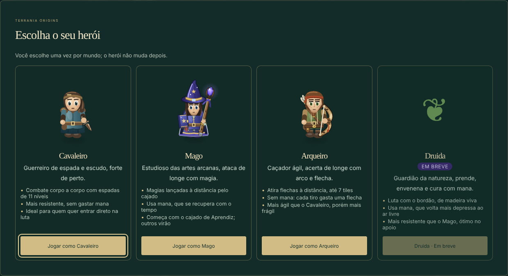

# ADR 0124 — O Druida entra como vocação (lote D1a: ficha, vida e mana)

**Estado:** entregue em 2026-11-28, primeira fatia do Druida de [DRUIDA.md](../DRUIDA.md). O dono respondeu **"sim"** à pergunta que faltava (a arma do Druida): será o **bordão**, a opção recomendada. O lote D1 do plano (vocação e primeiro bordão com a magia básica) é grande demais para uma entrega só; foi cortado como se fez com o Arqueiro ([ADR 0109](0109-arqueiro-a1a-vocacao.md)). Esta é a **D1a**: o Druida passa a **existir** no motor e aparece na tela de escolha, **bloqueado ("Em breve")**.

## O que mudou
- **A ficha** (`src/engine/character/classes/druid.ts`): nome Druida, **usa mana** (a do Mago: 50 no nível 1, mais 10 por nível, a barra enche em 20 s), **90% da vida** do Cavaleiro no mesmo nível (`DRUID_HP_PERCENT`; o Mago tem 80%), anda como o Cavaleiro, veste roupas, não usa espadas, `playable: false`. Os números são as propostas de `DRUIDA.md`; ajustam-se nesse arquivo.
- **A arma:** um novo tipo, `"crook"` (o **bordão**), ao lado de espada, cajado e arco (`WeaponKind`). Ainda sem bordão no jogo: só o tipo existe, para o D1b criar o catálogo.
- **Os espaços** do inventário, com nomes próprios: Cocar, Colar, Anel, Peitoral, **Bordão**, **Totem de mão** (no lugar do escudo), Calça e Botas. Sem mochila e sem flechas. Ainda não aparecem em jogo (ninguém joga de Druida), mas já estão definidos.
- **A tela de escolha** ganhou o quarto cartão (faixa "Em breve", botão desligado, os três traços do papel e uma **folha** no lugar do desenho, que só vem no lote D2). A janela ficou mais larga (quatro colunas no desktop; duas por linha até 1100 px; uma no celular).
- **O que fica para o D1b:** o bordão e a magia básica; o bônus de **recarga de mana ao ar livre** (+25% fora das cavernas), porque precisa saber onde o herói está e vai junto com a magia; o inventário do Druida e a liberação.

## Por que bloqueado
Faltam o bordão, a magia, o desenho e o inventário. Liberar agora daria um herói que não consegue atacar. O mesmo caminho do Mago e do Arqueiro: a vocação existe, a tela a mostra como "Em breve" e ela só é liberada ao ficar completa. Um save escrito à mão com `"heroClass":"druid"` é aceito como vocação conhecida (como era com o Arqueiro), mas ninguém o gera pelo jogo.

## Testes
`tests/druid-class.test.ts` (5): a ficha (nome, bordão, mana, 90%, velocidade, não jogável, o catálogo); os oito espaços e seus nomes, sem mochila nem flechas; a vida em cinco níveis e o herói Druida (90 de vida); a mana (a do Mago e o enchimento em 20 s); e o cartão (os textos, a folha, as quatro colunas e as duas por linha em telas médias). Ajustados `hero-classes`, `hero-select`, `archer-class` e `archer-inventory` (quatro vocações, três jogáveis). Navegador (desktop e Android): `hero-select` (o cartão do Druida bloqueado, com a faixa, a folha e o botão desligado; quatro cartões). **Mutações:** 14 tentadas (vida, mana base, mana por nível, recarga, jogável, tipo de arma, usa mana, nome e espaços, velocidade, o catálogo, a lista de vocações, as colunas e a folha), todas pegas.

## O que vem depois
**D1b:** o primeiro bordão e a magia básica no motor (mana por tiro, efeito natural), a recarga maior ao ar livre e o inventário do Druida; depois a liberação. Depois seguem D2 a D6 de `DRUIDA.md`.
